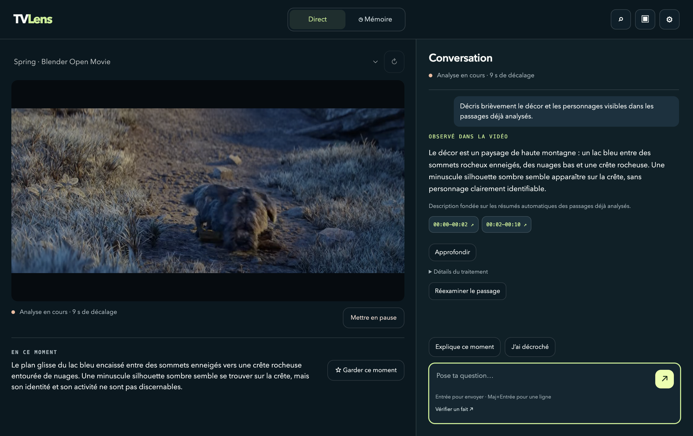
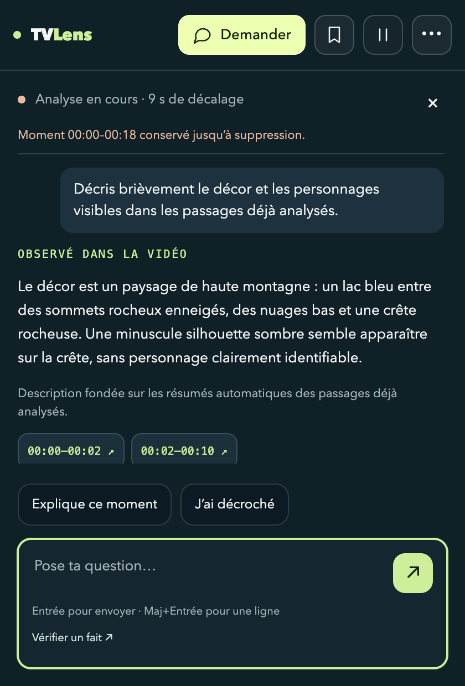
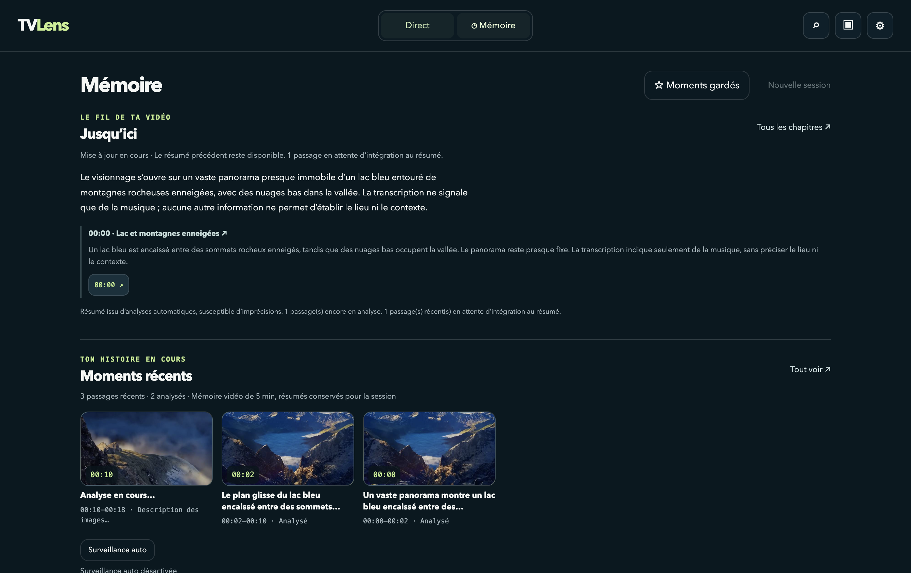
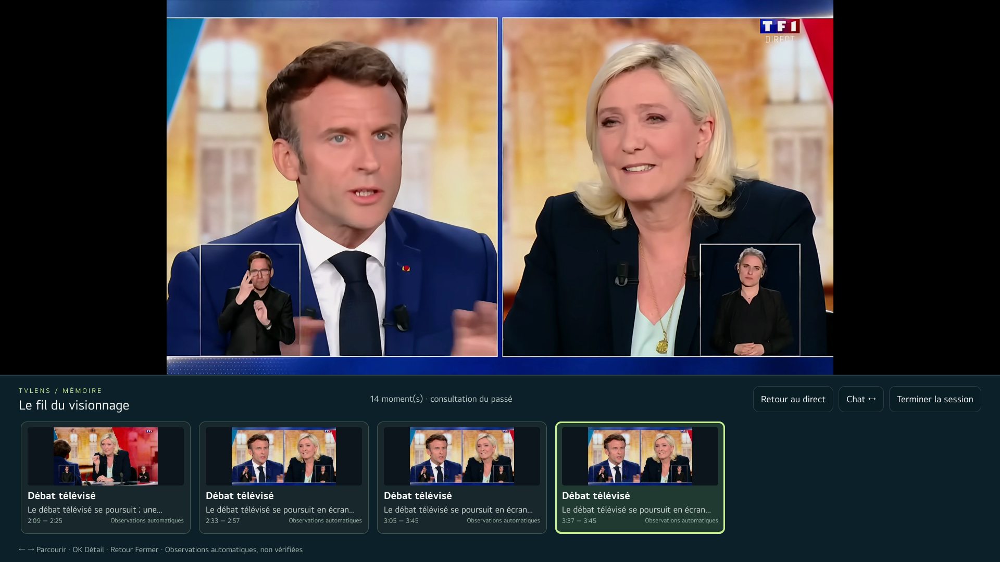

<div align="center">

# TVLens

### La vidéo continue. Le contexte reste.

**Pose une question sur ce que tu regardes. Retrouve le moment. Explore les preuves.**

Un compagnon de visionnage avec une mémoire audiovisuelle — sur Mac, puis directement à côté de YouTube sur une TV LG.

**App macOS · Companion LG · Frise de session · Chat & sources · Serveur privé Tailscale**

[Voir la démo vidéo](https://youtu.be/jOrcdLZsqT8) · [Essayer sur Mac](docs/installation.md) · [Companion TV](docs/lg-timeline.md) · [Déployer le serveur](docs/server-installation.md) · [Architecture](docs/architecture.md) · [Documentation](docs/README.md)

</div>

## TVLens en 58 secondes

[](https://youtu.be/jOrcdLZsqT8)

**[Regarder la présentation sur YouTube](https://youtu.be/jOrcdLZsqT8)** — une question pendant le visionnage, le passage retrouvé, des sources consultables et la mémoire du programme, sur TV et Mac. Le film utilise des interfaces reconstituées et un extrait réel de débat.



> **« Ça parle de quoi ? »** · **« Qu’est-ce qu’il disait tout à l’heure ? »** · **« Tu as une source ? »**
>
> Plus besoin de reconstruire tout le contexte dans un chatbot. TVLens observe le contenu, garde une mémoire de la session et rattache ta question au moment où tu la poses.

**POC fonctionnel et testé sur Mac et sur une LG rootée, avec calcul sur Mac ou VPS personnel.** Le chat et la vision utilisent aujourd’hui Codex ; Whisper transcrit l’audio sur l’hôte de calcul. L’inférence entièrement locale sur **ASUS Ascent GX10** est la prochaine hypothèse à valider.

## Une question, son contexte, ses preuves

TVLens ne se limite pas à décrire la dernière image. L’agent peut consulter la transcription, rechercher un moment passé, réexaminer les images disponibles et chercher des sources sur le web. Il réutilise la conversation et les preuves obtenues pour les questions suivantes.

| Tu veux… | TVLens te permet de… |
| --- | --- |
| **Comprendre le présent** | Poser une question sur le contenu récent, avec des références aux passages observés. |
| **Retrouver le passé** | Interroger la mémoire temporelle ; rechercher par texte et, avec OpenRouter, par similarité sémantique. |
| **Examiner un détail** | Réanalyser un intervalle avec des planches d’images numérotées et horodatées. |
| **Vérifier une information** | Consulter des sources externes et distinguer ce qu’affirme la vidéo de ce qu’elles étayent. |
| **Suivre le fil** | Parcourir les sujets et événements de la session, leurs résumés et leurs paroles disponibles. |
| **Poser plusieurs questions** | Utiliser une file visible, avec annulation individuelle et ancrage temporel conservé. |

Les états de capture, d’analyse, d’attente et d’erreur sont distincts. La progression décrit les étapes réellement exécutées, sans exposer de raisonnement interne. Une réponse provisoire n’est pas présentée comme une preuve vérifiée.

## Sur Mac : complet quand tu explores, discret quand tu regardes

**Direct** réunit la vidéo, le contexte et le chat. **Mémoire** rassemble les passages, le résumé progressif, la recherche et les moments gardés. Le **mode flottant** laisse le lecteur au premier plan : une barre compacte, un chat qui se déplie quand tu en as besoin.

<p align="center">
  
  
</p>

Les actions Mac permettent aussi de **garder un moment**, **rattraper ce que tu as manqué**, relire une citation disponible ou confier une **Surveillance** au compagnon, avec une consigne libre : « Vérifie les chiffres sur l’économie ». Elle commence à son activation et continue pendant tes questions. Ses résultats sourcés arrivent en cartes courtes, en bas à gauche ; ce qui n’a pas pu être vérifié reste dans l’historique.

Les sessions sont conservées : **Mémoire → Sessions** liste les sessions passées, les ouvre en lecture seule, reprend la capture sur demande, ou les supprime.

<details>
<summary>Voir la mémoire de session sur Mac</summary>



</details>

*Captures de l’app avec un véritable extrait de **Spring**. [Protocole et crédits](screenshots/current/README.md).*

## Sur la TV : le programme reste à l’écran

Sur la **LG 75QNED87T rootée de test**, YouTube continue pendant que TVLens propose deux vues exclusives :

- **Chat à droite** : question dictée via le micro du clavier LG, réponses et références temporelles.
- **Frise en bas** : environ un tiers de l’écran, vidéo entière réduite au-dessus, cartes par sujet ou événement sur toute la session.

**Une question à côté du programme**


**Le fil du visionnage, directement sur la TV**



*Captures réelles du compagnon LG prises le 2 octobre 2026 pendant un débat sur YouTube. Les descriptions visibles sont des observations automatiques, pas des faits vérifiés. [À propos des visuels](screenshots/lg/README.md).*

Les miniatures apparaissent dès réception ; titres et résumés arrivent avec l’analyse. Tu peux remonter le passé sans perdre ta position, ouvrir le détail, afficher les paroles ou **questionner ce moment** avec son intervalle attaché au chat. Les miniatures et les médias restent avec la session jusqu’à sa suppression.

Le companion s’ouvre avec **Rakuten** sur la télécommande configurée. La capture démarre manuellement ; **Arrêter / Reprendre** conserve le contexte. Retour ferme le panneau. Le bouton micro physique direct reste une fonction LG : la dictée TVLens passe par le clavier.

> **Version installée sur la TV de test.** Les changements du 13 octobre 2026 (questions de cinq minutes, sessions conservées, surveillance, alertes en bas à gauche) ont été installés sur la TV de test et sur le VPS le 13 octobre 2026 au matin, par la supervision et avec l’autorisation de Dabi, puis essayés par quelques parcours réels courts : cela ne vaut pas validation. À cette date, l’affichage d’alertes panneau fermé était désactivé par défaut, sans validation native.
> Voir [le livrable de la nuit](docs/night-features-delivery.md) et [l’historique des alertes panneau fermé](docs/lg-ambient.md).

**État du dépôt au 16 octobre 2026.** L’affichage ambient panneau fermé est retiré selon
l’[ADR 0017](docs/adr/0017-retrait-de-l-affichage-ambient-panneau-ferme.md) : page et outils, superviseur
et relais, gate de capture, puis intégrations de page et documents. Le panneau ouvert conserve
surveillance, activité et cartes sourcées ; alertes et durée (8, 14 ou 20 secondes) restent des choix
locaux. L’API overlay serveur et ses ETags sont conservés, avec retrait différé. Ce travail ne décrit
aucun déploiement ni désinstallation sur la TV ou le VPS.

→ [Navigation et frise](docs/lg-timeline.md) · [Capture et reprise](docs/lg-capture-control.md)

## Le même cœur, plusieurs lieux de calcul

| Parcours livré | Capture | Calcul et interface |
| --- | --- | --- |
| **Mac autonome** | Fenêtre/écran et son système via Electron | Moteur sur le Mac ; interface complète ou flottante |
| **LG → Mac** | Images et audio de YouTube sur la TV rootée | Moteur sur le Mac ; companion sur la TV |
| **LG → VPS privé** | Même adaptateur TV | Moteur Linux sans Electron ; échanges via Tailscale ; companion sur la TV |

Le serveur VPS écoute uniquement sur son adresse Tailscale, avec authentification par jeton. TVLens et Tailscale sont configurés pour démarrer automatiquement. La coexistence avec le LAN et CyberGhost Japon a été testée ; le VPN Internet reste indépendant du companion.

**Les interfaces n’ont pas encore toutes les mêmes commandes.** Le marque-page durable, la recherche dédiée, le résumé progressif et la relecture sont disponibles sur Mac. La TV dispose du chat et de la frise avec détail/paroles/question contextualisée ; sa frise n’ajoute pas de lecteur vidéo. La surveillance et les sessions archivées reposent sur le même cœur des deux côtés ; leurs écrans TV sont écrits, pas encore déployés ni validés sur l’appareil.

→ [Installer sur son serveur Linux](docs/server-installation.md) · [Mesures du VPS et retour au Mac](docs/vps-deployment.md) · [Tailscale sur la LG](docs/lg-tailscale.md)

## Essayer sur Mac

Depuis un clone du dépôt (`git clone https://github.com/DabiK/tvlens.git`, puis `cd tvlens`) :

Prérequis : **Mac Apple Silicon, Node.js 24+, Homebrew, Codex CLI connecté** et autorisations macOS pour l’écran et le son système.

```sh
npm ci
brew install ffmpeg
npm run setup:speech
# Facultatif : exposer les outils TVLens aux sessions Codex externes
npm run setup:codex
npm start
```

Choisis une fenêtre vidéo, lance l’observation, puis pose une question. Pour construire et ouvrir l’application :

```sh
npm run package:mac
npm run open:mac
```

La clé OpenRouter est **facultative** et sert uniquement aux embeddings texte. Sans clé, la recherche temporelle et lexicale reste disponible. Les identifiants restent hors du dépôt.

→ [Installation, modèles et dépannage](docs/installation.md)

## Installer le companion sur une TV LG

Le parcours TV est un **POC pour une LG déjà rootée et compatible**, testé avec YouTube. Il n’existe pas encore d’installateur universel ni de version dans le LG Content Store.

1. **Préparer le moteur** : sur Mac, installer les dépendances ci-dessus puis lancer `npm run start:server` ; sur Linux, suivre [le guide serveur](docs/server-installation.md), qui couvre Codex, Whisper, FFmpeg et systemd.
2. **Relier TV et hôte** : réseau privé accessible, ou Tailscale pour le VPS. L’adresse d’écoute doit être joignable depuis la TV ; le serveur reste authentifié par jeton.
3. **Installer les composants LG** : interface `tv/app`, contrôleur/capture `tv/` et gestion du panneau/télécommande `prototypes/lg-remote`. Suivre [le parcours LG détaillé](docs/lg-installation.md) ; certaines étapes dépendent du modèle et des accès déjà configurés.
4. **Appairer** le contrôleur et le panneau avec l’URL de l’hôte et son jeton, dans deux fichiers privés exclus de Git.
5. **Tester sur YouTube** : ouvrir TVLens, démarrer l’analyse, choisir la langue audio, dicter via le clavier LG et envoyer une question. Arrêter puis reprendre conserve le contexte de la session.

Le français est la langue audio par défaut du serveur ; le bouton **Audio** propose aussi Anglais et Auto. Le son est transcrit avec Whisper sur l’hôte, tandis que les images et transcriptions utiles sont envoyées à Codex. Le Mac autonome utilise le même cœur, avec Whisper sur le Mac : il ne dépend pas du VPS.

→ [Installation LG, fichiers et validation](docs/lg-installation.md) · [Répartition du calcul](docs/architecture.md) · [État des tests](docs/validation.md)

## Architecture : changer l’adaptateur, conserver le produit

Les sources produisent des segments horodatés. Le domaine gère mémoire, rétention, file des questions, intervalles et validation des citations. Capture, modèles, transcription, stockage et réseau restent derrière des ports interchangeables.

| Brique | Implémentation actuelle |
| --- | --- |
| Capture | Electron sur Mac ; adaptateur Python image/audio sur la LG rootée |
| Perception et réexamen | Codex, Luna par défaut ; planches de six images horodatées, sélection adaptative |
| Transcription | Whisper multilingue sur l’hôte Mac ou Linux |
| Chat et preuves | Codex App Server, fil par session, outils de contexte et recherche web |
| Mémoire | Médias, miniatures et textes de chaque session, conservés jusqu’à sa suppression ; sessions archivées consultables ; résumé progressif sur Mac |
| Surveillance | Consigne libre lue en continu, en parallèle du chat ; affirmations suivies jusqu’à un état explicite ; cartes regroupées et sourcées |
| Recherche sémantique | Embeddings texte OpenRouter à la demande, index JSON local et repli lexical |
| Interfaces | Electron complet/flottant ; companion webOS chat/frise |
| Hébergement distant | Service systemd sous utilisateur dédié, accès privé Tailscale |

Le chat reçoit ses outils directement via l’App Server. Un adaptateur **MCP** expose les mêmes capacités à des clients externes côté Mac ; il n’est pas nécessaire au fonctionnement du chat TV.

→ [Architecture hexagonale](docs/architecture.md) · [Rôles des agents et outils](docs/refactor-runtime.md) · [Contribuer](CONTRIBUTING.md)

## Ce qui est prouvé, ce qui reste à mesurer

- **Suite hors ligne** : 287 tests Node et 6 tests Python (`tests/test_tv_control.py`) passaient sur la base de la mission du 13 octobre 2026, avant ses changements. Le résultat de la suite après la mission, et ce qu’elle ne prouve pas, sont dans [le livrable de la nuit](docs/night-features-delivery.md).
- **Changements du 13 octobre 2026** (cinq minutes, sessions conservées, surveillance, cloisonnement) : prouvés par tests hors ligne, par un parcours Electron à fournisseurs simulés et, pour le cloisonnement, par des tours de modèle réels sur Mac. **Installés sur la TV de test et le VPS le 13 octobre au matin par la supervision ; essais réels courts seulement, sans valeur de validation (livrable, section 13).**
- Essais réels avec Whisper, Luna et Codex : description, transcription, questions successives, outils temporels, pause/reprise et réexamen.
- **TV → VPS : 24 secondes, 12 images et 3 segments reçus sans perte**, puis analyse et réponse. L’utilisateur a confirmé le panneau et la frise sur la TV.
- Lors du premier essai, avant séparation audio/vision, les trois blocs de 8 secondes ont pris **15 à 22 secondes chacun à analyser** : le réseau fonctionne, mais l’analyse peut prendre du retard. Ce court essai ne valide pas un visionnage continu prolongé.

```sh
npm test
npm run test:electron            # Capture synthétique, modèles simulés
node scripts/smoke-lg-ui.mjs
node scripts/smoke-tv-timeline.mjs
```

→ [Tests, mesures et échecs conservés](docs/validation.md)

## Confidentialité et limites du POC

- **Le POC n’est pas entièrement local** : Codex reçoit images et transcriptions. Avec le VPS, images et audio quittent aussi la TV vers cet hôte privé. Whisper y transcrit l’audio ; OpenRouter reçoit uniquement le texte à vectoriser.
- **Les médias d’une session restent sur le disque de l’hôte jusqu’à sa suppression explicite** : images, son, miniatures, paroles, réponses. Rien n’est purgé au bout de cinq minutes ni au redémarrage. Compter de l’ordre d’un gigaoctet par film, d’après une estimation hors ligne. Sous un plancher d’espace libre (1 Gio par défaut), la capture est refusée et rien n’est supprimé. `TVLENS_MEDIA_RETENTION_MS` rétablit une fenêtre glissante.
- **Cinq minutes de traitement par question au plus**, hors attente dans la file (cinq questions en attente au maximum) ; `TVLENS_QUESTION_TIMEOUT_MS` abaisse ce plafond. Pause/reprise garde le contexte. Après un redémarrage du moteur, la session est retrouvée dans la liste, archivée ou « interrompue » après un arrêt brutal : elle s’ouvre en lecture seule et la capture ne reprend que sur demande.
- **Les agents sont cloisonnés, pas isolés de façon absolue.** Ils n’ont ni shell ni lecteur de fichiers : c’est mesuré avec un vrai modèle pour le chat et le vérificateur seulement, sur Mac et pour une version de Codex, et établi sans modèle seulement pour la surveillance et l’analyse ; rien n’est mesuré sous Linux. Détail et limites : [SECURITY.md](SECURITY.md).
- Une observation, un OCR ou une accusation rapportée **n’est pas une preuve indépendante**. Les erreurs des modèles, de transcription et d’identification restent possibles.
- La source LG échantillonne des images : elle ne fournit pas une vidéo native continue. Un réexamen ne peut retrouver une action jamais capturée.
- La validation TV porte sur **YouTube et une LG rootée précise**. Compatibilité universelle, capture DRM, Netflix et Prime ne sont pas promises.
- Les quotas et dépenses sont suivis sans plafond local de consommation ; les limites des fournisseurs s’appliquent.

## Prochaine étape : mettre le moteur à l’épreuve du GX10

L’usage et les interfaces existent. L’objectif du challenge **ASUS Ascent GX10** est de remplacer les adaptateurs cloud par des modèles locaux, puis de mesurer une hypothèse précise : **peut-on suivre un visionnage continu tout en répondant aux questions, sans envoyer les images et les paroles à un fournisseur d’inférence ?**

À explorer ensuite : caméra + micro pour une TV non modifiée, analyse des actions rapides, embeddings multimodaux, validation sur la TV de la surveillance et des cartes du panneau ouvert, et expérimentation d’un moteur embarqué webOS. Ces pistes restent des travaux futurs.

---

**Crédit vidéo :** *Spring* (2019), réalisé par Andy Goralczyk — © Blender Foundation | [cloud.blender.org/spring](https://cloud.blender.org/spring), [CC BY 4.0](https://creativecommons.org/licenses/by/4.0/). Extraits visibles dans les captures d’interface ; le film n’est pas distribué dans le dépôt. [Provenance des médias](media/samples/README.md).
