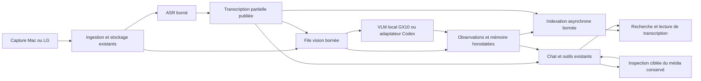

# TV Lens V2 — livraison backend en trois jours

**Document de travail consolidé — 12 octobre 2026.** Priorité utilisateur : un produit qui fonctionne dans trois jours, avec interfaces et fonctions existantes conservées, et un essai réel d’inférence locale sur GX10 dès que l’accès est disponible. Ce PRD définit le travail futur ; aucune implémentation, installation ni expérience décrite ici n’a été exécutée. Les budgets et arbitrages techniques sont des propositions d’Astra ; les seuils le sont aussi sauf l’objectif utilisateur explicite de traitement A en moins de cinq secondes, précisé plus bas. Ce document est la référence de livraison ; le [dossier d’expérimentations](../experiments/README.md) reste un réservoir de recherche, pas une seconde roadmap à exécuter.

## 1. Résultat produit recherché

Pendant que l’utilisateur regarde un contenu, TV Lens continue d’acquérir et d’analyser les passages. Une parole transcrite devient consultable sans attendre une description visuelle. Une question utilise les preuves admissibles les plus fraîches au moment où elle les consulte, retrouve un passage ancien si nécessaire et peut en réexaminer les images originales. L’utilisateur conserve Direct, Mémoire, sujets et récapitulatifs, questions et relances, navigation temporelle, citations, annulation et recherche web.

La V2 doit livrer deux résultats distinctement vérifiés : **un backend existant mieux exploité et mesurable**, et **une tranche de perception visuelle locale sur GX10 intégrée à TV Lens si l’accès et la compatibilité le permettent**. Une démo uniquement cloud ne vaut pas validation de l’objectif GX10. Inversement, un endpoint local qui décrit une image ne prouve pas une V2 complète ni un gain de performance.

Le calcul sera d’abord local à un GX10 éventuellement distant de la capture. Le transfert réseau est inclus dans les mesures. La cible ultérieure d’une machine proche et maîtrisée reste ouverte ; le repli Codex protège la livraison et ne décide pas de la cible finale.

### Hors périmètre des trois jours

Refonte UI, réécriture du domaine, base vectorielle ou bus d’événements supplémentaires, entraînement/finetuning, mémoire KV spécialisée, pipeline DINO/SAM/CLIP, détecteur de gestes universel, modèle omni obligatoire, remplacement du chat/web par un agent local, migration générale vers DeepStream/VSS, nouveau système de capture LG. Pas de réplication des six campagnes du registre. Les outils pour la perception sont différés ; les outils du chat existants sont améliorés en priorité.

## 2. Ce que le code permet de décider

Révision de référence : `3d2e320760c6dfa46de19504cede23b5c45c0225`. Revérifier ces points au démarrage de l’implémentation.

| Constat vérifiable | Implication V2 |
| --- | --- |
| [Mac](../app/recording.js) : média WebM natif et candidats visuels environ toutes les 400 ms ; blocs usuels de 8 s. | Réutiliser le média et le découpage existants avant de modifier la capture. La fermeture du bloc reste une attente mesurable. |
| [LG](../tv/capture.py) : quatre captures espacées d’environ 2 s ; [WebM reconstruit](../adapters/remote-media.cjs). | Ne pas promettre de retrouver les gestes entre prises. Une séquence avant/après peut montrer un changement durable, sans prouver tout le mouvement. |
| [Session](../core/session.cjs) : audio partiel publié, vision du même segment mise en file après transcription ; `asking` bloque ses nouveaux départs. | Préserver publication audio ; retirer seulement les barrières évitables après test de concurrence, sans prétendre que tout doit être simultané. |
| [ASR](../adapters/local-transcriber.cjs) : processus Whisper créé à chaque audio non caché. | Service résident candidat simple, mais économie de chargement à mesurer ; même modèle et langue d’abord. |
| [Réexamen](../adapters/clip-inspector.cjs) : extraction jusqu’à 8 fps, sélection et [planches](../adapters/inspection-strategies.cjs) déjà présentes. | Pas de nouveau tampon dense Mac ni de nouvel inspecteur scientifique. Une entrée vidéo native n’est pas nécessaire pour exploiter la vidéo conservée. |
| [Runtime](../runtime/session-runtime.cjs) : objets perception et inspection distincts, transcripteur partagé. | Ne pas inventer un conflit d’agent unique ; vérifier contention réelle et appels ASR concurrents. |
| [Outils](../core/video-tools.cjs) : snapshot figé, recherche/transcription/inspection bornées ; [index](../core/moment-index.cjs) créé séquentiellement à la demande. | Actualiser de façon bornée les preuves du même préfixe ; éviter le rattrapage complet des embeddings dans le chemin interactif. |
| [Perception](../adapters/codex-perception.cjs) utilisant un [agent sans outils](../adapters/codex-analysis-agent.cjs) ; [chat](../adapters/codex-session-agent.cjs) avec outils et fil persistant. | Ne pas reconstruire ce que le chat sait déjà faire. L’historique du fil ne se limite pas aux six passages fraîchement injectés. |

Les [mesures historiques](validation.md) donnent 5,182 s d’ASR en moyenne pour neuf blocs français d’environ huit secondes. Elles ne prouvent ni un goulot unique, ni le comportement sous questions, ni une performance GX10. Aucune vitesse publiée sur H100/A100 ou un modèle texte ne devient une promesse produit.

## 3. Architecture retenue : prolonger le runtime existant

Conserver un hôte Node TV Lens, ses ports, son stockage de médias et sa mémoire temporelle. Ajouter un seul backend VLM local dans la tranche GX10. Le service ASR résident est une optimisation secondaire conditionnelle, pas un second chantier obligatoire avant la démonstration.

**Asynchronisme borné, pas indépendance fictive.** Ingestion, publication des preuves disponibles et consultation ne doivent pas attendre la fin de toutes les modalités. La description visuelle actuelle utilise le transcript pour le sujet et son résumé cumulatif : conserver cette jointure dans la livraison initiale. Une vision autonome suivie d’une deuxième synthèse créerait davantage d’appels et de règles de fusion ; elle est différée sauf preuve qu’elle est indispensable au résultat. La V2 ne sera donc pas présentée comme un nouveau moteur audiovisuel intégralement décorrélé.

Pendant une question, une option de composition `visionDuringAsk` autorisera le départ d’un travail de perception locale, tout en gardant `visionRunning` et les files bornées actuels. L’activer d’abord lorsque la perception est sur GX10 et le chat/inspecteur sur Codex ; garder la pause actuelle pour le chemin entièrement Codex tant que le bénéfice n’est pas mesuré. Aucun ordonnanceur GPU nouveau : la vision locale a un seul actif, le chat reste sérialisé, l’ASR reste séparé. Tracer temps bloqué et tâches abandonnées. Si G3 échoue, désactiver cette option : aucune hausse silencieuse de pertes pour afficher une faible latence. Un futur inspecteur local partageant le GPU nécessiterait un arbitrage supplémentaire ; il est hors périmètre.

### Preuves et consultation fraîche

Conserver identifiant de passage, intervalle source, modalités et statuts distincts. Ajouter les temps nécessaires de réception, publication et consultation, ainsi qu’une révision de l’observation. L’audio reste propriétaire du transcript ; une observation visuelle ne doit pas écraser une transcription plus récente. Un résultat ASR `metrics.failed` ne doit pas être considéré comme une transcription réussie. Une donnée partielle exploitable reste utilisable avec ses limites.

**Politique proposée : ancrage fixe, actualisation aux frontières de consultation.** Garder session, début de scope et instant de question immuables. Au démarrage effectif de la réponse puis avant `search_moments` ou `get_transcript`, relire les versions disponibles des passages appartenant au préfixe autorisé. Exclure tout événement ultérieur, même déjà visible dans la session. Conserver une copie des preuves effectivement retournées pour valider la réponse. Pas de push en plein décodage, pas de boucle d’attente ou de régénération automatique. Une analyse qui arrive après la dernière consultation attendra une relance.

La validation doit référencer les preuves lues, pas reconstruire rétroactivement leur contenu depuis l’état courant. Si cette évolution met en danger causalité ou stabilité du délai, garder le snapshot figé pour la démo et mentionner explicitement la limite. Ce repli réduit l’ambition de fraîcheur ; il ne constitue pas une validation de l’actualisation.

Mécanisme limité proposé : injecter depuis [conversation-runtime](../runtime/conversation-runtime.cjs) un fournisseur de snapshot lié à **la session de la question**, puis ajouter `refresh()` à `VideoTools`. Seuls les IDs du snapshot initial dont les intervalles restent dans le scope sont actualisés, sans ajout d’événements ni changement d’ancrage. Copier un état cohérent synchroniquement avant chaque opération ; garder toutes les révisions effectivement retournées dans un journal de preuves du job, tout en remplaçant la vue courante. Corriger la déduplication actuelle de `remember()` par ID pour qu’elle n’empêche pas de consulter la révision récente. Relire également la disponibilité avant `inspect_clip` ; le lease reste l’autorité contre une purge concurrente. Les citations gardent leur format existant, mais l’audit indique les révisions consultées ; elles n’attestent toujours pas l’implication sémantique. Trois tests indispensables : partial→ready, futur exclu, expiration entre refresh et lease. Aucun événement historique arrivé tardivement mais absent du snapshot initial n’est ajouté dans cette V2.

### Outils et contexte : aucun nouveau catalogue

| Contrat existant | Évolution V2 et utilité |
| --- | --- |
| `search_moments({query})` | Recherche temporelle/lexicale immédiate ; utiliser seulement des vecteurs déjà disponibles et le budget courant. Aucun rattrapage complet de l’historique avant de répondre. Signaler le mode dégradé. |
| `get_transcript({startMs,endMs})` | Retourner le transcript disponible et son statut, indépendamment de la vision ; préserver les bornes actuelles. |
| `inspect_clip({startMs,endMs,question})` | Réutiliser extraction, planches, leases et cache. Limites actuelles : deux inspections, vingt secondes/quatre segments maximum par inspection. Mac peut apporter de nouvelles images ; LG peut seulement réexaminer les prises originales. |
| Contexte automatique | Garder un contexte récent minimal et les sujets existants ; la navigation ciblée complète ce contexte. Pas de nouvelle mémoire sémantique ni de checkpoints KV. |

### Index évolutif : ingestion asynchrone, consultation sans rattrapage

L’utilisateur souligne une dépendance réelle : les nouvelles preuves doivent alimenter l’index au fil du flux pour que `search_moments` reste utile. **Décision minimale retenue :** prolonger [MomentIndex](../core/moment-index.cjs) et [EmbeddingStore](../adapters/embedding-store.cjs), aujourd’hui un cache JSON lié au modèle et au texte exact. Aucune base vectorielle ni aucun bus supplémentaire dans les trois jours. Le besoin est la fraîcheur des données ; le choix de stockage est distinct.

Après publication d’une preuve exploitable, soumettre son `passageText` et sa révision à une file d’indexation en arrière-plan, sans attendre pour publier ni répondre. Un seul calcul actif, une file bornée configurable, coalescence par ID pour ne conserver que le texte le plus récent en attente. Le passage partial→ready n’entraîne un embedding que si le texte change. Identifier chaque travail par session, ID, révision/empreinte du texte et modèle ; avant d’écrire un résultat, vérifier qu’il correspond encore au texte courant. Un résultat périmé ne doit ni remplacer le vecteur récent ni être utilisé pour cette révision. Conserver le fournisseur déjà configuré ; absence de clé ou erreur donne une recherche lexicale, pas une ingestion bloquée.

Dans le chemin interactif, utiliser les vecteurs de passages **déjà disponibles pour le texte exact** (`cached_only`), sans appel à `ensure()` sur l’historique entier. Le vecteur de la requête peut être calculé dans un budget court et annulable ; s’il manque ou dépasse ce budget, répondre en lexical. Exposer mode de classement, nombre de passages à jour/en attente et âge de l’index. Le périmètre de recherche reste celui des preuves admissibles de la question, même si l’index de session connaît déjà le futur.

Annuler les travaux en attente à la fermeture/changement de session et ignorer toute réponse tardive ; borner les retries et compter coalescences/abandons. L’expiration d’un média brut n’efface pas son résumé historique ni son vecteur si ce texte reste consultable, mais interdit toujours l’inspection. Purger entrées et travaux quand le passage ou la session textuelle est supprimé ; éviter la croissance indéfinie du cache par ancien texte. Le stockage JSON et sa file d’écriture restent un compromis mesuré sur G3, pas une promesse de montée en charge illimitée.

Ajouter aux traces délai publication→vecteur utilisable, couverture de l’index par révision, taille/âge de file et temps de recherche. Les trois tests ciblés portent sur partial→ready pendant un calcul, annulation de session et fallback lexical immédiat. L’index est **progressivement à jour**, jamais garanti instantané. Si ce poste dépasse deux heures, livrer lexical + cache exact existant, marquer l’indexation continue non validée et retirer d’abord l’actualisation des preuves pendant les outils pour préserver le budget.

Un checkpoint signifie ici repère temporel ou sujet relié aux passages déjà stockés. Il ne déclenche pas une extraction de métadonnées vidéo. Garder expiration des médias à cinq minutes par défaut, distinction résumé/preuve, scopes, annulation et huit appels d’outils maximum. Toute réutilisation de transcript lors d’une inspection doit correspondre à l’intervalle réellement couvert ; ne pas transformer un transcript de huit secondes en citation exacte sur une sous-seconde.

### Comparaison A/B demandée : clip vidéo ou sélection légère de X images

**Variante A :** traiter un clip d’environ cinq secondes avec un modèle acceptant la vidéo et obtenir sa description complète en **moins de cinq secondes de traitement**. Cet objectif de débit est maintenant explicitement demandé par l’utilisateur ; ce n’est ni un résultat publié établi ici ni une performance promise sur GX10. Compter la fin de génération et la validation, pas le premier token. Des clips successifs ne rendent pas automatiquement le modèle stateful ; une entrée vidéo peut être prétraitée en images échantillonnées.

**Nemotron Omni : quantité d’information et longueur de description.** L’utilisateur demande de comparer, avec ce même modèle, une description courte, moyenne et autour de 100 tokens, puis une longueur adaptative selon la richesse de la séquence : peu de texte pour une scène stable, davantage pour plusieurs événements. La réponse publiée de 15 tokens en 0,64 s est grossière et ne prouve pas que la mémoire sémantique serait suffisante. Aucune règle linéaire ne permet d’en déduire le temps de 100 tokens ; aucune extrapolation n’est retenue comme objectif ou performance.

Intégrer cette comparaison à G1/G2 sur le même clip de cinq secondes, puis sur un clip de quinze secondes seulement si le budget le permet. Fixer média, frames effectives, résolution, runtime, quantification, langue, réglage de thinking et état des caches ; distinguer froid et chaud, répéter chaque configuration retenue plusieurs fois dans le budget, sans croiser tous les paramètres. Mesurer prétraitement, prefill et décodage jusqu’à la réponse complète lorsque le runtime les expose ; sinon déclarer la décomposition indisponible. Relever tokens réellement générés, arrêt naturel, troncature et JSON incomplet. `max_tokens` est un plafond, pas une longueur obtenue ; le raisonnement peut consommer un budget distinct ou partagé selon le runtime, à documenter même s’il n’est pas visible dans la réponse.

Comparer d’abord les longueurs fixes sur omissions, ordre des événements, précision, citations et utilité pour une question ultérieure. Évaluer ensuite une politique adaptative avec plafond explicite dans la même requête, sans imposer un appel supplémentaire pour estimer la complexité. Une sortie plus longue peut aussi répéter ou inventer : sa longueur ne vaut pas qualité. L’objectif cinq secondes→description complète en moins de cinq secondes reste inchangé. Le test quinze secondes est facultatif, et la comparaison de longueurs remplace des variantes optionnelles de G2 dans les deux heures existantes ; aucune quatrième campagne ni nouveau modèle.

**Variante B :** l’utilisateur propose de conserver environ cinq minutes de vidéo dense, d’observer les changements image par image par un calcul léger, puis de sélectionner X images sur une fenêtre d’environ cinq secondes pour alimenter le modèle images existant. Son hypothèse est qu’une entrée image sélectionnée pourrait préserver les événements tout en réduisant l’inférence par rapport à la vidéo. **Hypothèse retenue pour un essai court, pas résultat acquis ni choix définitif de modèle.** B ne garantit pas une perte légère. Les cinq minutes sont un horizon de conservation ou un extrait d’essai ; ne pas attendre cinq minutes avant de commencer l’analyse.

**Réemploi retenu pour B — ordre de priorité :**

| Priorité | Implémentation existante | Décision dans les trois jours |
| --- | --- | --- |
| 1 | [visualChange et selectFrameCandidates](../core/frame-policy.mjs) : différences globales, tuiles locales et contours ; première/dernière image, réduction des grands intervalles, avant/changement, sortie chronologique bornée. | Réutiliser avec des candidats plus denses issus du WebM Mac. Pas de nouvel algorithme appris. Conserver les ancrages réguliers et vérifier avant/pendant/après ; la sélection actuelle ne garantit pas systématiquement ce triplet ni un écart maximal quand X est insuffisant. |
| 2, seulement si faiblesse constatée | [FFmpeg scdet](https://ffmpeg.org/ffmpeg-filters.html#scdet), [code](https://github.com/FFmpeg/FFmpeg/blob/master/libavfilter/vf_scdet.c). | Signal de coupe de scène en complément, via FFmpeg déjà présent. Ce n’est ni un détecteur fiable de petit objet ni un sélecteur de X images complet. Aucun ajout par défaut. |
| Différé | [Farnebäck](https://www.ida.liu.se/ext/WITAS-ev/Computer_Vision_Technologies/PaperInfo/farneback03.html), [exemple OpenCV](https://github.com/opencv/opencv/blob/4.x/samples/python/opt_flow.py). | Estime les déplacements entre deux images ; plus de coût et de réglages pour caméra/coupes. Ne mesure pas l’importance sémantique. Hors chemin nominal. |

[PySceneDetect](https://github.com/Breakthrough/PySceneDetect) est une alternative de détection de scènes, pas une brique à ajouter en plus de FFmpeg : Python/OpenCV/NumPy supplémentaires, et réglages de voisinage/durée minimale à adapter aux événements brefs. Voir les [références et licences](../experiments/bibliographie.md). Aucun code n’est installé ou importé à cette étape.

Le score actuel compare précédent/courant, mais le choix des X images sur une fenêtre de cinq secondes se fait à sa clôture : compter cette attente et ne pas utiliser une image ultérieure à l’ancrage de la question. Les candidats actuels sont plafonnés à 64 et le score est calculé sur 64×36 pixels ; vérifier ces bornes pour une source dense. Une petite balle peut disparaître à la réduction même si la vidéo l’a capturée. Décoder/observer progressivement la fenêtre, conserver les références nécessaires et n’encoder en JPEG que les X images sélectionnées dans le prototype ; ne pas redécoder les cinq minutes à chaque fenêtre. Compter décodage, réduction, score, sélection et encodage. Garder le média natif pour le réexamen.

Une variation visuelle n’est pas une importance sémantique ; coupe, caméra ou mouvement répétitif peuvent prendre le budget à un geste discret. Le timebox de deux heures vise un essai hors ligne réutilisant le code. L’estimation de recherche de 0,5–1 journée pour une intégration dense reste indicative, non approuvée et extérieure à ce timebox : aucune promesse de perception dense continue en production à l’issue du prototype.

Le Mac dispose déjà du média natif, d’un [score de changement](../app/recording.js) et d’une [sélection avec points temporels et avant/après](../core/frame-policy.mjs), mais les candidats sont espacés d’environ 400 ms. Densifier l’observation légère à partir du WebM peut donc apporter des événements absents de ces candidats ; il ne faut pas réinventer le sélecteur. Le LG n’a actuellement pas cette source dense. Le décodage de son WebM reconstruit ne peut pas fournir une balle bleue apparue pendant 100 ms entre deux prises.

Même un échantillonnage uniforme de 200 ms peut manquer cet événement selon sa phase. Le moniteur doit réellement recevoir les images qui le contiennent ; calcul léger ne signifie pas coût nul de décodage. Une variation globale peut manquer une petite balle : réutiliser les différences locales existantes, garder des observations avant/pendant/après et leurs timestamps, puis comparer coupes et mouvements caméra comme faux positifs. Une image prouve éventuellement une présence, pas une trajectoire. Un budget X fixe peut supprimer des preuves lorsque plusieurs événements se concentrent : enregistrer cette limite, ne pas promettre une conservation complète de la sémantique.

**Option choisie dans G2 :** sur un unique extrait Mac dense de cinq minutes, comparer A (clip) à B (sélection dense, budget proposé X = 6), avec mêmes fenêtres, demande de description et modalités. Pour B, garder la sélection actuelle comme contrôle. Inclure le cas d’apparition de 100 ms dans les douze cas déjà prévus ; mesurer couverture, ordre avant/pendant/après, coût du décodage/sélecteur et qualité finale. Journaliser fréquence et images effectivement encodées ; si le backend les masque, l’indiquer. Des backbones différents ne permettent pas d’attribuer tout écart au format. Prélever l’extrait avant expiration ou le conserver explicitement comme média de test autorisé, sans changer la rétention produit.

Séparer attente de fermeture, décodage/sélection, transfert, file, encodage et génération complète. L’objectif `< 5 s` concerne le traitement du clip disponible, tandis que le délai événement → description inclut aussi capture et réseau. Le coût de sélection de B reste compté même s’il est anticipé. Le passage de G2 ne prouve pas le débit soutenu : G3 vérifie aussi des fenêtres successives et des questions concurrentes, sans croissance du retard ni pertes dissimulées. La qualité temporelle et les citations restent des conditions de décision.

Le budget de l’A/B est deux heures maximum, pris sur le poste optionnel de J3 **à la place de l’ASR résident** ; une finalisation GX10 nécessaire reste prioritaire. Il inclut au plus un candidat vidéo dont le runtime est disponible ou vérifié dans ce budget ; ce candidat d’essai ne remplace pas automatiquement le backend de livraison. Pas de migrations en chaîne pour obtenir un résultat. Si A ne peut pas être exécutée, inscrire « non testé », jamais « trop lent » ou « perdant ». Si un gain est établi et l’intégration reste bornée, choisir la variante ; sinon garder le chemin produit connu. La fenêtre de cinq secondes ne décide pas de remplacer les blocs produit de huit secondes pendant ce sprint. Aucune règle « image toujours plus rapide » ou « vidéo toujours lente » n’est adoptée. Voir le [protocole E02](../experiments/registre.md).

**Résultats documentaires disponibles au 12 octobre 2026 — aucune mesure GX10 TV Lens.** Ces relevés rendent l’objectif plausible, sans constituer un comparatif homogène ni valider cinq secondes de vidéo décrites en français en moins de cinq secondes.

| Source et configuration | Chiffre publié | Portée et limite |
| --- | --- | --- |
| [Essai d’auteur Nemotron 3 Nano Omni NVFP4](https://dev.classmethod.jp/articles/dgx-spark-nemotron3-nano-omni-multimodal-launch-bench/), DGX Spark, vLLM 0.20, 29 avril 2026 | Vidéo de convoyeur 15 s, réponse de 15 tokens : **0,64 s** annoncée. Commande avec échantillonnage 2 fps, maximum 256 et pruning 0,5. | Source empirique tierce primaire, pas benchmark constructeur. Pas de répétitions vidéo, résolution/frames effectives ou frontières de chronométrage suffisamment établies pour transposer ce chiffre. Ne valide pas le geste de 100 ms ni une description française complète. |
| [Essai d’auteur Qwen3-VL-8B BF16](https://dev.classmethod.jp/articles/nvidia-dgx-monitoring/), Spark, Transformers | Recherche parallèle : 16 clips de 9–15 s, fichiers à 5 fps surtout 720p ; prétraitement **0,289 s**, `generate` **5,638 s**, cycle médian **5,94 s**. | Sortie de **deux tokens de classification**, pas description. Article inaccessible lors de notre revérification ; chiffres attribués au relevé de recherche parallèle, non revérifiés exhaustivement ici. Ne permet pas de déclarer A trop lente pour cinq secondes. |
| [NVIDIA VSS 3.2, RT-VLM](https://docs.nvidia.com/vss/latest/performance-rt-vlm.html), Spark, FP8/vLLM, blocs 10 s, 80 frames 448×448, captioning 100 tokens | Streaming : bloc prêt→réponse **8,61 s** en moyenne, **p95 8,65 s**. Fichier 10 s : **6,04 s**. | Chiffres constructeur, modes distincts. Page incohérente sur le nom du modèle (Cosmos3 Nano Reasoner en présentation, CR2-8B en note) : checkpoint non certifié ici. Pas d’extrapolation linéaire à cinq secondes ; attente de formation du bloc exclue du délai streaming. |

La littérature consultée ne fournit pas de benchmark public complet directement comparable au cas TV Lens demandé. A et B restent ouvertes. Retenir au plus **un candidat vidéo** selon le runtime effectivement disponible dans la timebox, sans campagne à deux modèles ni adoption de VSS pour reproduire son chiffre.

Pour le candidat Nemotron, la [fiche NVIDIA NVFP4](https://huggingface.co/nvidia/Nemotron-3-Nano-Omni-30B-A3B-Reasoning-NVFP4) annonce DGX Spark et environ 21 Go, avec anglais documenté : le français reste à tester. La [NVIDIA Open Model Agreement, section 2](https://www.nvidia.com/en-us/agreements/enterprise-software/nvidia-open-model-agreement/) accorde un usage sans redevance, y compris commercial sous ses conditions. L’exécution locale des poids via vLLM n’impose pas un abonnement NVIDIA ; cela ne rend gratuits ni le matériel ni un éventuel service cloud/NIM. Ces éléments autorisent à considérer le candidat, sans imposer son adoption ni garantir sa qualité.

**Correction retenue sur les preuves LG :** propager la provenance de capture (`native`, `stills`, `unknown`) et le nombre de prises originales jusqu’au réexamen, sans analyser de nouvelles métadonnées. Pour `stills`, sélectionner les images originales horodatées plutôt que présenter le décodage du diaporama comme de nouvelles observations. Conserver le média reconstruit pour la lecture. Distinguer nombre de prises et nombre d’images décodées ; une cellule de remplissage n’est pas une prise supplémentaire. Ne pas dédupliquer par égalité de pixels deux véritables captures à des temps différents. Les archives sans provenance deviennent `unknown`, jamais implicitement `native`. Cette correction ne change pas la cadence LG et conserve le plafond serveur actuel.

### Avis ciblé : seconde sélection visuelle guidée par la question

**Verdict Astra après challenge Fable 5.1, effort medium : différer l’ajout au produit.** L’idée utilisateur est conservée : première passe de changements/candidats, puis classement visuel conditionné à la question, éventuellement choix de régions, puis preuves à l’agent conversationnel. Aucun besoin mesuré ne justifie actuellement une nouvelle brique dans les trois jours. Un diagnostic court peut remplacer une variante optionnelle de G2 ; un essai de reranking ne devient utile que si ce diagnostic révèle une preuve présente mais mal retrouvée/sélectionnée. Rien n’a été exécuté.

OpenCV est une bibliothèque de vision, d’algorithmes et d’exécution de réseaux, pas un type de LLM. La répétabilité d’un score ne prouve pas sa justesse sémantique. Le nom « JEV » reste non résolu ; aucun produit n’est supposé choisi. Un encodeur image-texte tel que [CLIP](https://arxiv.org/abs/2103.00020), [code officiel](https://github.com/openai/CLIP), illustre le rôle de classement, sans décision de l’intégrer ni garantie de compatibilité ARM/GB10 ou de qualité française.

**Valeur potentielle :** retrouver un objet, une personne ou une action silencieuse que le transcript **et la description visuelle** ont omis. La recherche actuelle indexe déjà les deux ; une question visuelle n’exige donc pas systématiquement un nouvel index. Si les images pertinentes ne survivent pas à la première sélection, le reranker ne peut pas les récupérer. Garder les ancrages réguliers, une voie de récupération depuis le média conservé et des séquences avant/pendant/après ; une personne statique peut survivre aux ancrages, mais ce n’est pas garanti pour tout détail. Un top-k d’images « femme » ne démontre ni le geste ni son ordre.

| Option | Arbitrage |
| --- | --- |
| Reranking à la question sur un petit pool borné | Seul candidat à un essai ultérieur : comparer aux mêmes candidats et au même budget final d’images. Compter décodage, encodage/classement et inférence finale ; le bénéfice net n’est pas acquis. |
| Embeddings visuels calculés en fond | Déplace du travail hors de la question, mais ajoute modèle, calcul, cache et gestion d’expiration. Ne nécessite pas forcément une nouvelle base, mais dépasse le simple index texte prévu ; différé. |
| Scan visuel des cinq minutes à chaque question | Risque de coût et de délai élevé non mesuré ; pas retenu pour la livraison. Ne pas en déclarer une impossibilité universelle. |
| Juge génératif oui/non par image ou grounding de régions | Ajoute des inférences et peut perdre la chronologie. Régions et classement de frames sont des problèmes différents ; pas de nouveau détecteur/crop dans cet essai. |

Une similarité image-texte est un indice de classement, pas une preuve ni un oui/non universellement calibré. Un seuil peut être évalué, jamais présumé juste. Les vecteurs CLIP ne sont pas interchangeables avec les embeddings textuels actuels. Localiser « la femme qui ouvre le tiroir » ne permet pas d’inventer son nom : une identité doit être étayée par une source effectivement capturée/consultée. Respecter scope, ancrage, disponibilité et leases ; les textes/paroles des médias restent des données non fiables, et un JSON valide ne neutralise pas une erreur sémantique ou une injection.

**Diagnostic proposé, sans campagne supplémentaire :** trois ou quatre questions G2 sur personne statique, petit objet rare, action muette et répétition. Vérifier successivement présence dans le média, présence dans les candidats, mention dans le texte, résultat de recherche, puis inspection `sheets-diverse` et citation. La stratégie `sheets-crop` existe dans [inspection-strategies](../adapters/inspection-strategies.cjs), mais appelle `selectRegion`, absent de l’adaptateur CodexPerception actuel ; le runtime de production utilise `sheets-diverse`. Elle n’est donc pas une baseline prête à exécuter sans travail supplémentaire.

Si les outils actuels répondent correctement, ne rien ajouter. Si la preuve manque déjà dans les candidats, travailler couverture/ancres plutôt que reranking. Si elle existe dans un petit pool admissible mais est omise par la recherche/sélection, comparer éventuellement baseline et +reranking sur ce même pool, modèle final inchangé, budget final d’images égal et chronologie préservée. Mesurer aussi les manqués du premier filtre sur le média source. Arrêter si aucun gain de réponses/citations n’apparaît, si une preuve utile est perdue ou si le coût complet dépasse le budget sans gain pertinent. Sans runtime déjà disponible et compatible, différer ; pas d’installation en chaîne. Toute cette option remplace du travail G2 dans ses deux heures, sans s’ajouter aux variantes vidéo/longueur de description. Le classement reste derrière la préparation d’inspection existante, sans nouvel outil du chat ni outil de perception.

## 4. Tranche locale GX10 : objectif explicite et borné

**Candidat initial retenu pour compatibilité : Ollama avec `gemma3:4b`.** Le playbook officiel NVIDIA Live VLM WebUI documente cette combinaison sur DGX Spark 128 Go. Cela justifie un premier essai sur la famille GB10 ; cela ne certifie pas le GX10 fourni, sa variante 64/128 Go, le français, les gestes ni le débit. Ne pas installer Live VLM WebUI dans le produit : réutiliser le backend HTTP seulement.

La recette transporte une webcam et analyse des images échantillonnées. Son [service VLM](https://github.com/NVIDIA-AI-IOT/live-vlm-webui/blob/main/src/live_vlm_webui/vlm_service.py) reconstruit chaque requête avec un prompt et une seule image, sans historique ; il ignore une candidate si une inférence est déjà en cours et remplace le texte affiché après la réponse complète. Il n’apporte ni mémoire temporelle ni audio synchronisé. Une candidate toutes les 500 ms avec une inférence de deux secondes implique des candidates ignorées, pas une analyse toutes les 500 ms. TV Lens conserve ses preuves indépendamment de la fréquence des appels VLM.

Un adaptateur de perception local implémente le contrat existant `observeVisual(segment)` et produit le même schéma validé. Sa composition conserve `transcribe(segment)` via le transcripteur actuel : le détecteur `splitPerception` exige les deux méthodes. Réutiliser prompt, contexte et validation communs plutôt que maintenir une copie divergente. Entrée : images existantes chronologiques, temps, transcript disponible et contexte admissible. Sortie : champs attendus, incertitudes et métriques réelles. Requête envisagée : `POST /api/chat`, images base64 sans préfixe data URL, `format` contenant le schéma JSON et `stream:false`. Valider la sortie côté application même avec génération contrainte. Aucun appel d’outil par ce modèle. Ne pas confondre cette entrée multi-image avec une compréhension vidéo native.

Le préflight utilise une vraie entrée complète TV Lens : pas seulement une image avec « décris ceci ». Fixer et enregistrer `options.num_ctx` après vérification du volume texte/images accepté, sans supposer qu’une taille par défaut suffit. Fixer `keep_alive` pour la durée de session, distinguer chargement/échauffement et inférence chaude, puis libérer le modèle selon le cycle de vie choisi. Une valeur numérique de contexte n’est pas une garantie d’absence de troncature : vérifier entrée et sortie. Annulation cliente et travail serveur sont mesurés séparément. La mémoire 64/128 Go et les versions restent enregistrées comme conditions d’essai, même pour un petit modèle.

Garder chat, web et inspecteur Codex au premier passage : l’essai local porte sur la perception, et son résultat doit être visible dans les cartes de TV Lens. Les requêtes vont de l’hôte actuel vers le GX10 par un accès privé authentifié, sans exposer directement un endpoint d’inférence public. Aucun déplacement du serveur, du stockage ou de la capture n’est requis pour cette tranche. Conserver les durées transport + inférence et l’identité réelle du backend ; ne jamais enregistrer un fallback Codex comme une mesure locale. Choisir le backend pour la session ; sur panne persistante, arrêter les nouvelles tâches locales, signaler le mode dégradé et basculer explicitement pour les suivantes. Journaliser la frontière, ne pas lancer deux fournisseurs pour le même travail et ne pas renommer l’historique. Marquer tout résumé cumulatif traversant cette frontière comme produit à partir d’observations de backends différents.

**Budget proposé : six heures actives cumulées pour la tranche locale**, dont 90 minutes maximum de diagnostic matériel/accès/backend, environ trois heures d’adaptateur et validation, puis 90 minutes de smoke/corrections. Ce budget est inclus dans J1–J3. Confirmer matériel/mémoire/OS, backend GPU effectif, réponse française structurée sur les entrées TV Lens et annulation/timeout. Téléchargement et attente d’accès ont aussi une échéance de calendrier : ils ne justifient pas de dépasser le gel. Un seul candidat ; pas de succession Ollama → vLLM → TensorRT → modèle plus gros. Si une pile déjà fonctionnelle est fournie avec la machine, elle peut remplacer ce candidat après vérification du contrat, sans seconde migration.

Statut final obligatoire : **validé sur GX10**, **fonctionnel mais refusé pour qualité/débit**, **incompatible dans le budget**, ou **non testé faute d’accès**. Si accès arrive après le gel de J3, faire au plus un smoke séparé autorisé ultérieurement ; ne pas fragiliser la démo. L’objectif local demeure non atteint sans preuve sur la machine, même si les tests avec un faux backend passent.

### ASR résident : optimisation conditionnelle

Le serveur officiel `whisper.cpp` propose `/inference` avec WAV et peut conserver le modèle chargé. Implémenter un adaptateur au même port seulement si la mesure initiale montre un gain utile et si la tranche GX10 laisse du temps. Même poids multilingues et paramètres au début ; file bornée commune à capture et inspection. Repli CLI actuel sur panne identifiée, sans lancer les deux calculs en parallèle. Couper la requête cliente ne prouve pas l’arrêt du calcul serveur : suivre l’occupation jusqu’à la fin ou isoler le service avant de relancer. Pas d’ASR streaming ni nouveau moteur dans ce délai.

## 5. Trois vérifications qui décident, pas une campagne de recherche

L’objectif A de description complète en moins de cinq secondes pour un clip de cinq secondes vient de l’utilisateur. Les autres durées, tailles et seuils suivants sont **proposés pour l’exploration, non approuvés et non promis**. Réutiliser les scripts et fixtures existants avant d’en créer. Aucun appel réel n’est autorisé par cette étape documentaire.

| Vérification | Protocole court proposé | Décision et repli |
| --- | --- | --- |
| G1 — compatibilité et coût | Dix blocs français/images identiques, froid puis chaud ; perception actuelle vs locale si GX10 accessible. ASR CLI/résident seulement si budget. Chronométrer transport, file, calcul et sortie utile. | Aucun JSON invalide non géré ; qualité française examinée cas par cas. Garder local si débit et qualité acceptables, sinon Codex identifié. ASR résident seulement si gain net mesuré, pas par intuition. |
| G2 — preuves et mouvement | Douze cas courts proposés : parole seule, visuel seul, synchronisé, ordre inversé, geste bref, répétition, détail ancien, preuve tardive du même préfixe, futur interdit, trou, expiration, source web. Comparer perception de routine et inspection actuelle sur même média. | Zéro violation causalité/provenance ; abstention quand geste absent. Une variante ne gagne pas seulement parce qu’elle reçoit plus d’images. Pas de passage à « vidéo native » sans backend compatible et bénéfice observé. |
| G3 — session soutenue et démo | Replay proposé de trente minutes avec douze questions réparties, dont une rafale de trois ; répéter la configuration finaliste si temps. Test de surcharge séparé au-delà de la file autorisée. | Retard et mémoire ne dérivent pas ; couverture/pertes au moins aussi bonnes que baseline. Revenir séparément sur ordonnancement, refresh ou backend qui régresse. |

Mesures : âge des dernières preuves audio et visuelles, couverture par intervalle et lacunes ; temps arrivée → publication → utilisation ; premier token, première information provisoire utile et réponse complète vérifiée séparés ; p50/p95 de bout en bout incluant file et transfert ; justesse sémantique/ordre/gestes, abstention, citations ; appels/tokens, CPU/GPU/mémoire et débit soutenu. Douze questions donnent un p95 exploratoire fragile, pas une certification de production.

La rafale vérifie l’acceptation et la mise en file, pas trois générations simultanées : conserver un actif et cinq attentes, ordre FIFO et annulation. Aucun job accepté ne disparaît ; le surplus reçoit un rejet explicite. Le timeout de traitement reste distinct du temps passé en file, inclus dans le délai utilisateur. Ne pas ajouter de parallélisme chat ou changer ses limites pour réussir le test.

Règle proposée pour conserver une optimisation de vitesse : gain d’au moins 20 % sur la métrique directement ciblée, sans nouvelle erreur critique sur G2, sans hausse de pertes, et sans dégradation du p95 complet supérieure à 10 %. Ces pourcentages sont des seuils de tri proposés, à réviser face aux exigences réelles ; ne pas accepter automatiquement une baisse de qualité pour gagner des millisecondes. Un backend local peut rester une démo technique séparée s’il fonctionne mais ne passe pas le critère produit.

Grille de qualité minimale proposée : pour chaque cas G2, noter réponse juste/partiellement juste/fausse ou abstention justifiée/injustifiée, ordre et citation séparément. Aucune nouvelle erreur sur un cas de causalité, attribution ou geste inventé ; nombre de réponses justes au moins égal à la baseline et revue des écarts individuels. Ce petit ensemble sert au tri, sans prétendre mesurer la qualité générale du français.

## 6. Roadmap ordonnée J1 / J2 / J3

Hypothèse d’effort : une personne connaissant le dépôt, trois journées de six à huit heures utiles. Chaque journée réserve du temps de stabilisation. Les travaux optionnels consomment ce budget, ils ne s’ajoutent pas en soirée. Aucun chemin ne suppose l’arrivée du GX10 à une date garantie.

| Jour et budget proposé | Travail / dépendances | Résultat vérifiable et règle d’arrêt |
| --- | --- | --- |
| **J1 : 7–8 h** | 1 h : baseline et traces minimales. 4 h : tranche locale, adaptateur/faux backend puis préflight réel dès accès ; G1 fait partie de cette tranche. 1 h : publication/statuts et option `visionDuringAsk`. 1–2 h : cas G2 et corrections. | Cartes alimentées par vrai GX10 si G1 passe, sinon adaptateur prêt et motif de blocage précis. App actuelle toujours utilisable. Pas de deuxième stack locale. |
| **J2 : 7–8 h** | 2 h : indexation asynchrone bornée et recherche sans rattrapage. Jusqu’à 2 h : actualisation des preuves et tests, priorité au début de traitement ; refresh pendant les outils seulement s’il tient dans ce budget. 2 h : provenance LG et réexamen des prises originales. 1–2 h : G2/corrections. Si accès GX10 arrive ce jour, son diagnostic remplace du budget refresh, sans s’y ajouter. | Index progressivement à jour sans bloquer les questions, fraîcheur et limites explicites, images LG correctement qualifiées. Si un poste dépasse son plafond, appliquer son repli, sans rogner la démo. |
| **J3 : 6–8 h** | Jusqu’à 2 h : solde de la tranche locale dans le plafond cumulé de 6 h ; si déjà terminé, A/B vidéo versus sélection dense de G2 à la place de l’ASR résident. 3–4 h : G3 et régressions. 1–2 h : démo et compte rendu ; gel. | Démo reproductible, backend et limites identifiés, fallback exercé. Rien de non vérifié activé par défaut. Aucun nouveau modèle après gel. |

Si J1 déborde, retirer d’abord ASR résident, puis actualisation pendant les outils (garder uniquement refresh au début du traitement), puis concurrence accrue. Conserver validation des preuves, tranche d’intégration locale et temps de démonstration. Si le GX10 reste inaccessible, affecter son temps de diagnostic aux régressions, sans déclarer son objectif réussi. Une cadence LG plus dense n’entre que si l’appareil et une méthode existante sont immédiatement disponibles ; sinon conserver la limite de capture et démontrer les gestes sur une source Mac réellement dense.

L’ajout de l’hypothèse de sélection dense rend l’ASR résident non planifié dans le budget nominal : il reste une piste documentée après livraison. L’option dense elle-même est retirée avant de rogner sur les régressions si le reste déborde.

Les trois gates partagent les mêmes médias et questions, sans créer trois corpus. Si le temps manque, supprimer les variantes optionnelles et les répétitions de performance, pas les cas critiques de causalité/provenance ni la démo de repli. Un G3 raccourci rend la stabilité longue non validée : inscrire cette limite plutôt que transformer un smoke en essai soutenu. L’augmentation de cadence LG et les repères supplémentaires injectés au chat ne sont pas des tâches nominales de cette roadmap.

## 7. Acceptation et démonstration

- Direct/Mémoire, sujets/récapitulatif, navigation LG/Mac, relances, outils et web continuent de fonctionner. Annulation, timeout, saturation, fin de session et expiration restent explicites.
- Transcript partiel utile avant vision ; aucune donnée audio effacée par un résultat visuel. Les états incomplets et les erreurs ne sont pas présentés comme preuves complètes.
- Questions ancrées sans futur ; citations limitées aux preuves effectivement consultées ; sources web réellement ouvertes ; limites de scope et de média inchangées. Zéro régression sur ces invariants.
- **V2 optimisée validée :** au moins une amélioration mesurée de fraîcheur ou de temps de réponse sur la baseline, sans masquer une perte de couverture. **Livraison de repli :** si aucune ne passe G1–G3, fournir une démo stable et le constat ; le gain V2 reste non validé. L’essai GX10 possède séparément son statut, sans être réputé réussi par ce repli.
- Démonstration locale : même passage → requête exécutée sur GX10 → résultat structuré → carte TV Lens → question citée. La présence éventuelle de Codex pour la réponse est annoncée ; cette démo n’est pas « tout local ».
- Démonstration temporelle : geste sur média Mac dense puis question ciblée, avec inspection existante ; cas LG manqué entraînant une limite ou abstention. Ne pas comparer une source LG clairsemée à un original dense comme si seul le modèle changeait.
- Démonstration de repli : indisponibilité locale gérée, état/backend correctement affiché dans les diagnostics, puis chemin produit connu. Les résultats des deux backends restent séparés.

Pour l’implémentation future : tests de domaine ciblés sur publication, file, scopes, preuves tardives et annulation, puis suite existante et smoke Electron selon [CONTRIBUTING](../CONTRIBUTING.md). Pas de remplacement des tests par une démo heureuse. L’édition de ce PRD nécessite seulement contrôle de liens, cohérence et diff ; ces tests applicatifs n’ont pas été lancés pendant sa rédaction.

## 8. Arbitrages de la confrontation Astra / Fable

Deux passes Claude CLI ont été réalisées avec le modèle principal exact `claude-fable-5-1`, effort `high`, en lecture/recherche seules : proposition prescriptive, puis réponse aux objections Astra et au draft de ce PRD. La première passe n’avait pas pu lire les rapports hors dépôt ; leur contenu intégral a été inclus dans la seconde. Les rapports bruts restent hors dépôt ; cette section conserve les arbitrages utiles à l’implémentation. La concordance entre agents n’est pas une preuve de performance.

| Désaccord ou critique | Arbitrage final Astra et motif |
| --- | --- |
| Fable proposait de reporter tout GX10 après J3. | Rejeté : l’objectif utilisateur exige une tranche locale dans les trois jours. Fable a révisé sa position ; un seul backend/candidat et six heures cumulées rendent l’essai borné. |
| Fable proposait vision autonome, densité LG accrue et quatrième outil de checkpoints. | Retirés du chemin nominal : risque sur sujets/résumés, dépendance à l’accès TV et contrat supplémentaire. Fable les a retirés ; réemploi de l’inspecteur et des outils existants. |
| Fable rejetait toute actualisation pendant une question. | Accord après critique du mécanisme précis : refresh aux frontières, ancrage fixe, révisions lues conservées. Astra maintient tests et repli strict ; actualiser la vue ne doit pas écraser le journal des preuves déjà utilisées. |
| Fable a révélé le comptage trompeur de frames LG reconstruites. | Retenu et recoupé dans `clip-inspector`/`frame-selection` : prises originales, images décodées et cellules de remplissage distinguées. Aucun doublon de rendu ne crée de preuve. |
| Fable concluait à un goulot audio unique. | Reformulé : poste coûteux dans certains essais, sans preuve globale sous concurrence. Mesurer aussi fermeture des blocs, transport, vision, recherche et attente utilisateur. |
| Fable recommande contexte Ollama explicite, échauffement et backend tracé. | Retenu. Sa valeur de contexte indicative et son maintien chargé permanent ne sont pas des exigences : dimensionner le contexte réel, gérer le cycle de vie et mesurer froid/chaud. |
| Fable rapproche skip de Live VLM et files TV Lens, et suggère de réutiliser systématiquement le cache ASR. | Non retenu tel quel : ignorer une candidate occupée diffère d’une file bornée ; un sous-extrait audio a un autre hash et une autre portée de citation. Garder les preuves sources et ne réutiliser que ce qui couvre effectivement l’intervalle. |

La direction initiale « perception continue légère + index de preuves + inspection ciblée » est donc réduite au produit existant : files et statuts mieux exploités, adaptateur VLM local étroit, consultation fraîche sous contrôle, réexamen déjà livré. Aucun nouveau modèle temporel ou système de mémoire n’est importé.

## 9. Références filtrées pour agir

- **Backend local retenu pour le premier essai :** [playbook NVIDIA Live VLM WebUI](https://raw.githubusercontent.com/NVIDIA/dgx-spark-playbooks/main/nvidia/playbook-live-vlm-webui/README.md), [code du testbed](https://github.com/NVIDIA-AI-IOT/live-vlm-webui), [Ollama](https://github.com/ollama/ollama), [API](https://github.com/ollama/ollama/blob/main/docs/api.md). Réutiliser le backend, pas ajouter l’UI au produit. Recette Spark 128 Go, validation GX10 encore nécessaire.
- **Modèle candidat :** [Gemma 3 Technical Report](https://arxiv.org/abs/2503.19786), [implémentation officielle](https://github.com/google/gemma_pytorch). Multimodal et multilingue ; aucune garantie spécifique sur gestes, français TV Lens ou débit de cette configuration.
- **ASR résident conditionnel :** [papier Whisper](https://arxiv.org/abs/2212.04356), [serveur officiel whisper.cpp](https://github.com/ggml-org/whisper.cpp/tree/master/examples/server). Réemploi concret d’un service existant, sans adoption d’un moteur différent ni promesse de streaming ; le papier ne prouve pas le gain du serveur résident pour TV Lens.
- **Principe observation/réponse :** [Flash-VStream](https://arxiv.org/abs/2506.23825), [code officiel](https://github.com/IVGSZ/Flash-VStream). Retenir la séparation des rôles, pas intégrer son modèle/mémoire. Son premier token rapide sur A100 ne mesure pas l’arrivée des preuves TV Lens.
- **Sélection ciblée :** [ReViSe](https://arxiv.org/abs/2602.13602), [code officiel](https://github.com/Chenwei-1999/SparseVideoUnderstanding). Inspire le réexamen borné ; la V2 réemploie l’inspecteur du dépôt plutôt que d’importer entraînement et boucle de sélection.
- **Questions temporelles :** [TemporalBench](https://arxiv.org/abs/2410.10818), [page auteurs](https://temporalbench.github.io/). Quelques cas d’ordre/comptage pour G2, pas une reproduction du benchmark.
- **Sélection légère proposée par l’utilisateur :** [AdaFrame](https://arxiv.org/abs/1811.12432) étudie la sélection adaptative, avec apprentissage et mémoire globale : pas un sélecteur causal prêt à brancher. [ColorTrigger](https://arxiv.org/abs/2603.22466) observe continuellement en gris et déclenche le RGB : le coût de l’observation grise subsiste, et la capture caméra diffère de LG. [TimeChat-Online](https://arxiv.org/abs/2504.17343), [code officiel](https://github.com/yaolinli/TimeChat-Online), supprime des tokens après encodage : ce n’est pas un remplacement direct du sélecteur d’images. Ces travaux motivent le petit test G2 ; aucun n’est ajouté comme composant V2.

StreamingVLM/StreamMem et autres mémoires KV, MoViNets/SlowFast comme nouvelle voie de calcul, migration générale vers un modèle omni et indexation visuelle par entités sont différés : coût d’intégration et validation incompatibles avec trois jours. Le petit essai Nemotron Omni de la variante A reste possible dans le budget A/B défini, sans engager cette migration générale. Leur intérêt scientifique est conservé dans la [bibliographie exploratoire](../experiments/bibliographie.md). Les recettes VSS, TensorRT-LLM, DeepStream ou Speech NIM ne sont pas le raccourci choisi : elles introduiraient une migration supplémentaire avant de prouver le bénéfice produit.
