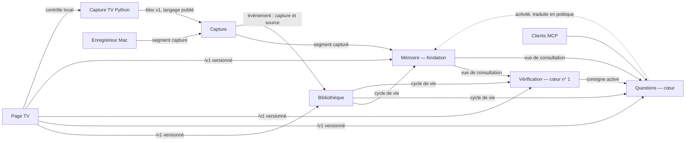
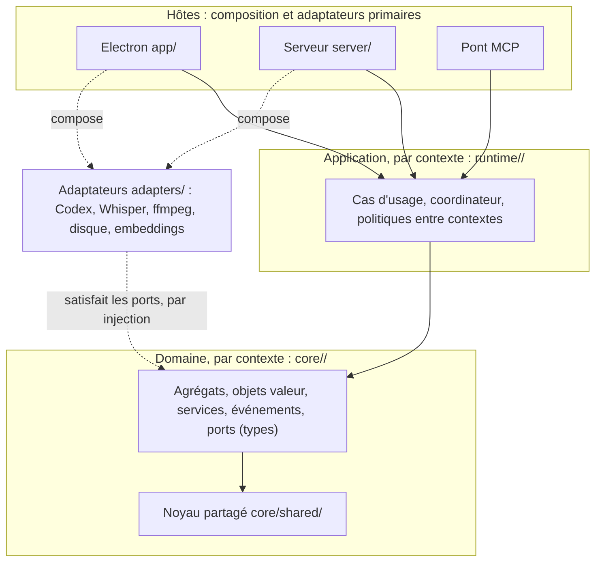

# Le domaine de TVLens

La cible vers laquelle le code évolue, et le langage qu'il parle. Elle a été figée le 16/10/2026 à partir de deux
analyses indépendantes du code (commit `ea6ce06`), d'une revue critique de la cible (commit `a45b187`) et des
décisions du propriétaire. L'ADR 0029 en tire les règles d'architecture, l'ADR 0030 le cycle de vie unique des
sessions.

Ce document décrit une **cible**. Le code d'aujourd'hui n'y est pas encore : chaque section dit d'où l'on part. Un
repère `chemin:ligne` vaut au commit `a45b187`.

## 1. Ce que fait TVLens

TVLens regarde avec toi, sur le Mac ou sur une TV LG, et garde une mémoire de ce qui passe à l'écran et dans le son.
Il tient trois promesses, dans cet ordre :

1. **Vérifier.** Une affirmation entendue reçoit une évaluation sourcée : étayée, contredite, mitigée ou insuffisante.
   Jamais « vrai » ou « faux ». Une source ne compte que si sa page a été ouverte.
2. **Répondre avec le contexte.** Une question est figée à l'instant où on la pose. Sa réponse ne cite que des passages
   réellement consultés.
3. **Surveiller.** Pendant le visionnage, les affirmations que le spectateur veut suivre sont détectées et vérifiées
   d'elles-mêmes.

Une règle tient les trois : **chaque perte est comptée, jamais passée sous silence.**

La capture, les modèles et le stockage sont des moyens. TVLens mémorise des **observations multimodales** : chaque
passage dit ce qu'il contient (image, son). Aujourd'hui, toute source fournit l'image et le son. L'audio seul ou une
autre application (Netflix) s'ajouteront par une fiche de source, sans abstraction préalable.

## 2. Les sous-domaines

| Sous-domaine | Type | Pourquoi |
| --- | --- | --- |
| Vérification | **cœur** | La promesse n° 1 : ce qui distingue TVLens d'un simple lecteur |
| Questions | **cœur** | Répondre avec preuves à partir de ce qui a été vu |
| Mémoire | **cœur, fondation** | Les deux cœurs ne valent que ce que vaut la mémoire ; tous les contextes la lisent |
| Capture | support stratégique | Indispensable, mais sans règle métier propre au-delà de l'admission et des pertes |
| Bibliothèque | support | Cycle de vie et rangement des sessions |
| Inférence, parole, média, disque, embeddings | générique | Codex, Whisper, ffmpeg et sharp, fichiers, OpenRouter : derrière des adaptateurs |

## 3. Les contextes

Cinq contextes. Chacun a un nom de dossier anglais, utilisé dans `core/<nom>/` et `runtime/<nom>/`.

### Capture — `capture`

- **Responsabilité.** Faire entrer ce qu'on regarde : un segment capturé, admis une seule fois, ou une perte avec sa
  cause.
- **Modèle.** La fiche de source (`Source`) et ses modalités, l'exécution de capture (`CaptureRun`), le segment
  capturé, le bloc de la TV, les causes de perte.
- **Trois sortes de non-arrivée**, à ne pas confondre :
  - le bloc **perdu avant livraison** : file d'envoi du Mac saturée (`app/recording.js:84`), bloc TV invalide ou file
    TV pleine (`tv/capture.py:137`, `:149`) ;
  - le bloc **refusé à l'admission** par le serveur ;
  - la **répétition** d'un bloc déjà reçu, qui n'est pas une perte.
  Un diagnostic garde, quand ils sont connus, la session, l'exécution de capture, la séquence et l'intervalle.
- **Invariants.** Un bloc est possédé dès son admission (ADR 0006, 0023). Les séquences croissent au sein d'une
  époque. Un doublon reçoit une réponse idempotente, dans la fenêtre de 100 blocs gardée en mémoire par exécution du
  serveur (`server/ingest-routes.cjs:5`) : aucune garantie au-delà, ni après un redémarrage. Une seule préparation à la
  fois.
- **Modalités absentes.** Le transport accepte un bloc sans son (`adapters/remote-media.cjs:36`) ; le producteur Python
  abandonne aujourd'hui certains blocs dont l'audio a échoué (`tv/capture.py:137`). La cible dit, par modalité, ce qui
  est accepté.
- **Événements.** `CaptureStarted {source}`, `BlockLost {cause}`, `BlockRefused {cause}`, `CaptureStopped {reason}`.
- **Aujourd'hui.** `app/recording.js`, `runtime/capture-intake.cjs`, `server/ingest-routes.cjs`,
  `adapters/remote-media.cjs`, `tv/capture.py`, `tv/transport.py`, `tv/controller.py`. YouTube est écrit en dur
  (`tv/capture.py:108`).

### Mémoire — `memory`

- **Responsabilité.** La mémoire de visionnage d'une session : les passages dans l'ordre, leurs deux voies
  (transcription, observation), leurs pertes, leurs sujets, le résumé vivant et la recherche.
- **Agrégat racine.** `ViewingMemory`, une par session (aujourd'hui `WatchSession`, `core/session.cjs:47`).
- **Invariants.** Les passages sont dans l'ordre d'observation. Un identifiant n'est jamais réutilisé. Un passage dure
  60 s au plus. Rien n'est admis dans une session arrêtée. Les voies sont bornées et ne perdent rien en silence.
  Une observation est redemandée une seule fois après un échec passager (ADR 0008). Le disque plein suspend
  l'admission sans rien supprimer.
- **Modules.** Voies, pertes, sujets (`Topic`, `TopicSummary`), résumé vivant (`LivingRecap`), recherche
  (`MemorySearch`, dont l'index est un abonné des passages), ligne de temps (`Timeline`, une projection), format
  d'archive versionné.
- **Langage publié : la vue de consultation.** Ce que les autres contextes ont le droit de lire. Elle remplace la
  lecture du snapshot complet, qui sert aujourd'hui à sept consommateurs. Elle définit :
  - l'identité de la session et son horloge ;
  - les passages, chacun avec sa révision, sa disponibilité (média rejouable ou non, et pourquoi) et ses modalités ;
  - la couverture et les pertes ;
  - les ports de lecture des médias, avec leurs baux.
  Les questions consomment plus qu'une liste de passages (`core/video-tools.cjs:19-31`, `:100`, `:157`) : la vue doit
  le couvrir, sinon les consommateurs réimporteront les structures internes.
- **Politique de traitement.** La Mémoire ne connaît ni les questions ni la surveillance. Elle reçoit une politique
  générique, par exemple « retenir la voie vision ». La coordination la traduit depuis l'activité des autres
  contextes, selon le réglage `visionDuringAsk`, activé par défaut sur le Mac (`app/main.cjs:65`).
- **Événements.** Un passage change plusieurs fois : la transcription arrive, puis l'observation, et sa révision monte
  (`core/session.cjs:293`, `:351`). La Mémoire publie donc `PassageReceived`, `PassageUpdated {revision}` (y compris
  après un enrichissement visuel ou un changement de disponibilité), `PassageLost {lane, cause}`,
  `AdmissionSuspended {storage-full}` et `MemoryReopened`. Chaque événement nomme la session, le passage et la
  révision. Chaque consommateur dit quelles révisions et quels états le rendent éligible : le résumé vivant attend les
  passages prêts (`core/living-recap.cjs:50-54`), la surveillance relit un passage après son visuel
  (`core/surveillance.cjs:451-458`). À la restauration ou à l'activation, un consommateur s'initialise sur la vue
  courante : les événements ne sont pas un historique.
- **Aujourd'hui.** `core/session.cjs`, `core/perception-context.cjs`, `core/topic-summary.cjs`,
  `core/living-recap.cjs`, `core/moment-search.cjs`, `core/moment-index.cjs`, `core/session-timeline.cjs`.

### Questions — `inquiry`

- **Responsabilité.** Répondre à une question figée à son instant, avec des outils bornés et des preuves validées.
- **Agrégat racine.** `QuestionQueue`, **une par session**, avec l'entité `Question`. L'ancrage reste celui de chaque
  question.
- **Qui pose des questions.** Seule la **session chargée** soumet des questions. Une archive rouverte en lecture seule
  est chargée : elle en reçoit, sa mémoire restant figée. Décharger une session annule et sauvegarde sa file ; aucune
  file déchargée ne continue à soumettre de travail.
- **L'agent.** L'agent Codex est partagé par l'hôte, qui en donne l'accès exclusif : l'adaptateur enchaîne déjà les
  appels l'un après l'autre (`adapters/codex-session-agent.cjs:53`). Une question ne devient « en cours » qu'au moment
  où l'agent lui est donné. **La fin visible d'une question, la disponibilité de l'agent et la libération des outils
  sont trois états distincts** (ADR 0004 : les outils restent retenus jusqu'au vrai retour de l'agent).
- **Invariants.** Cinq questions en attente au plus, une seule en cours. L'ancrage est figé à l'envoi. Le plafond court
  depuis le départ effectif. Une citation tombe dans un passage réellement consulté.
- **Événements.** `QuestionQueued`, `QuestionStarted`, `QuestionSettled {status}`, `QuestionActivityChanged`.
- **Aujourd'hui.** `core/deep-ask.cjs` (file, service et dépôt à la fois, un par hôte), `core/video-tools.cjs`,
  `core/viewing-actions.cjs`, `runtime/conversation-runtime.cjs`, `app/moment-actions.cjs`. Une archive accepte déjà
  des questions et les sauvegarde (`app/main.cjs:159`, `:500`, `runtime/headless-runtime.cjs:416`).

### Vérification — `verification`

- **Responsabilité.** Évaluer des affirmations avec des sources : la surveillance continue (`ClaimWatch`) et la
  vérification manuelle (`FactCheck`). Les deux partagent l'évaluation sourcée et la clé de page.
- **Agrégat racine.** `ClaimRegistry`, un par session (aujourd'hui `Surveillance`, un par hôte, remis à zéro à chaque
  session). Il garde ses **activations** : le dédoublonnage vaut par activation (`core/surveillance.cjs:689`).
- **`FactCheck` reste indépendant** du registre et de la session : il marche sans session chargée et a sa propre
  conservation (`core/verification.cjs:9`, `app/main.cjs:232-240`).
- **Invariants.** Une consigne active à la fois. Rien de ce qui précède l'activation n'est lu. Chaque passage après
  l'activation entre dans exactement un seau. Chaque affirmation finit dans un état terminal. Un lot de vérification
  contient trois affirmations au plus (`:728`, `:741`). Un relevé n'a ni source ni verdict.
- **Saturation.** 600 est un **seuil**, pas un plafond : à partir de 600 affirmations, aucun nouveau lot de détection ne
  démarre. Le lot déjà admis est gardé en entier et va au bout de sa vérification ; un registre peut donc dépasser 600
  de quelques unités (`:588`, `:616`, `:715`). L'interface affiche « surveillance saturée » : la raison
  `registry-full` existe déjà (`:854`, `:863`).
- **Événements.** `WatchStarted`, `WatchStopped`, `ClaimDetected`, `ClaimFlagged`, `BatchSettled {card?}`,
  `RegistrySaturated`.
- **Aujourd'hui.** `core/surveillance.cjs` (921 lignes), `runtime/surveillance-runtime.cjs`, `core/verification.cjs`.
  Les raisons sont des phrases, traduites par la page TV.

### Bibliothèque — `library`

- **Responsabilité.** Le cycle de vie des sessions et leur rangement : ouvrir, mettre en pause, finir, archiver,
  reprendre, supprimer, lister. Les moments gardés y vivent aussi, comme copies indépendantes de leur session
  d'origine.
- **Agrégat racine.** `SessionRecord` : l'identité et les métadonnées durables d'une session (titre, hôte, dates,
  archivée ou non, exécutions de capture et leur source). Une ancienne exécution peut avoir une source inconnue, et
  l'historique des captures est plafonné à 100 entrées (`runtime/session-manifest.cjs:9`, `:67-76`) : la fiche ne
  promet pas ce que les anciennes archives n'ont pas.
- **États qui ne sont pas dans la fiche.** « Chargée » et « en fermeture » appartiennent au coordinateur. « Interrompue »
  et « illisible » sont des projections de la bibliothèque, calculées à partir des fichiers
  (`adapters/session-library.cjs:34-47`, `:89`).
- **Un document, un seul agrégat rédacteur.** Le magasin remplace des documents entiers, il ne fusionne pas leurs
  champs (`adapters/local-store.cjs:157`).
- **Processus.** `SessionCoordinator`, **un seul pour les deux hôtes** (ADR 0030). Il appelle lui-même les étapes
  obligatoires de la fin. Chaque hôte déclare ses capacités et ses étapes propres.
- **Invariants.** Une session n'est « archivée » qu'après la barrière d'écriture (ADR 0002). Rien n'est effacé sans
  scellement (ADR 0007). Une archive garde sa **mémoire figée** jusqu'à une reprise explicite ; les questions et les
  enrichissements autorisés s'y enregistrent sans reprise de capture. Une seule session chargée par hôte. Les
  transitions sont sérialisées.
- **Événements.** `SessionStarted`, `SessionPaused`, `SessionResumed`, `EndStarted`, `SessionArchived`,
  `SessionDiscarded`, `SessionDeleted`, `SessionReopened`. Ils annoncent un état déjà établi.
- **Aujourd'hui.** `runtime/session-*.cjs`, `runtime/headless-session-lifecycle.cjs`, `adapters/session-library.cjs`,
  `core/saved-moments.cjs`, et la fin Mac dans `app/main.cjs:344-499`, écrite une seconde fois.

## 4. La carte des contextes



- **La Mémoire est en amont de tout.** Elle n'importe aucun autre contexte. Les autres lisent sa vue de consultation
  ou s'abonnent à ses événements.
- **La page TV parle à deux processus** : le serveur TVLens, par `/v1`, et le contrôleur de capture de la TV, en local
  (`tv/controller.py`). Elle seule atteint les deux.
- **Les langages publiés** sont versionnés : le fil `/v1` entre la page TV et le serveur, le bloc et le rapport de la
  capture Python.
- **Les couches anti-corruption** (Codex, Whisper, ffmpeg et sharp, Luna, disque) traduisent les fournisseurs en
  ports du domaine. Aucun message ni statut d'un fournisseur ne remonte tel quel.

## 5. Les couches



Une flèche pleine se lit « importe ». La page TV, la fenêtre Mac, le processus MCP et la capture Python sont hors
processus : ils parlent aux hôtes par HTTP ou IPC.

**Les ports sont des types**, déclarés en JSDoc dans le domaine, comme aujourd'hui dans `core/ports.cjs`. Un
adaptateur les satisfait par sa forme et reçoit ses dépendances par injection : il n'importe jamais `runtime/`. Un port
ne devient jamais une classe à importer.

## 6. Les règles de dépendance

Chaque règle dit comment elle est contrôlée : **garde** (`tests/architecture.test.cjs`, table de zones), **test de
contrat**, ou **relecture**.

1. `core/<contexte>/` importe seulement son contexte et `core/shared/`. Ni `process`, ni `fetch`, ni `Buffer`, ni
   disque, ni horloge ou minuterie globale. — *garde*
2. **Le domaine d'un contexte n'importe jamais le domaine d'un autre.** Seule l'application (`runtime/<contexte>/`)
   lit un autre contexte, par son module public `core/<contexte>/index.cjs` ou par événement. La Mémoire n'importe
   aucun autre contexte. — *garde*
3. `runtime/<contexte>/` importe son domaine, le noyau et les modules publics des autres contextes. Jamais `adapters/`,
   jamais `runtime/compose/`. — *garde*
4. `runtime/compose/` n'est importé que par les hôtes. — *garde*
5. `adapters/` n'importe ni `runtime/`, ni `app/`, ni `server/`. Un adaptateur de rôle n'importe pas un autre rôle.
   — *garde*
6. Le domaine et l'application ne produisent aucun statut HTTP. Les hôtes et les adaptateurs de réponse média
   traduisent leurs résultats en réponses de transport, y compris pour les protocoles Electron
   (`adapters/local-store.cjs:234-257`). — *garde*
7. Aucune comparaison de message d'erreur : une erreur porte un `code` déclaré par son module émetteur, sur la base
   `core/shared/domain-error.cjs` (T201). — *garde et test de contrat*
8. Les gestionnaires IPC et HTTP n'appellent que des services d'application et n'écrivent aucun champ d'agrégat.
   — *garde*
9. Les étapes obligatoires de la fin sont appelées par le coordinateur, jamais confiées à un abonné. — *test de
   contrat et relecture*
10. Electron seulement dans `app/`. `sharp` et `ffmpeg` seulement dans les adaptateurs média. Le client Codex
    seulement dans ses adaptateurs. — *garde*
11. Page TV : scripts classiques (ADR 0011), `fetch` seulement dans `remote-client.js`, libellés indexés par codes.
    — *garde*
12. Python : seul `tv/luna.py` appelle `luna-send`, seul `tv/sources.py` nomme une application. — *garde*

**La garde doit d'abord évoluer.** Aujourd'hui, une zone est un préfixe choisi par longueur, et une permission vaut
pour un motif exact (`tests/architecture.test.cjs:16`, `:149`). Ajouter `core/memory/**` change donc la zone de ses
fichiers : chaque zone qui les importe doit recevoir la nouvelle permission. Avant la première sous-zone, la garde
apprend les points d'entrée publics (`index.cjs`) et les exceptions temporaires, avec leurs tests.

## 7. Les dossiers

On garde `core/`, `adapters/` et `runtime/`, et on range l'intérieur par contexte :

```
core/shared/         intervalle, clé de page, texte de passage, erreur du domaine, diffuseur d'événements
core/capture/        fiche de source, modalités, contrat de segment, bornes
core/memory/         ViewingMemory, voies, pertes, sujets, résumé vivant, recherche, format d'archive, projections
core/inquiry/        Question, QuestionQueue, validation des réponses, portée, intentions, limites
core/verification/   ClaimRegistry, clé d'affirmation, détection, verdicts, cartes, FactCheck
core/library/        SessionRecord, règles de session (vide, disque plein), moments gardés
runtime/<contexte>/  services d'application du contexte ; runtime/library/ porte le coordinateur
runtime/compose/     compositions partagées par les deux hôtes
adapters/            par famille : codex/, speech/, media/, storage/, embeddings/, simulated/
server/              HTTP /v1, routes, projections du fil
app/                 Electron : composition Mac, tables IPC par contexte, contrôleurs de la fenêtre
```

Le code nouveau naît dans ces dossiers. Un gros fichier se vide module par module et reste une façade tant qu'il
sert. Le code extrait arrive dans son nouveau fichier sans infraction : le ticket corrige celles du code qu'il déplace,
pas celles du reste du fichier d'origine (`docs/standards.md:71-72`). Un fichier entier ne change de chemin qu'une
fois débarrassé de ses infractions gelées.

## 8. Les événements

- Un agrégat **enregistre** ses événements ; il n'appelle plus `onChange` au milieu d'une transition.
- Le service d'application **publie après la transition**, une fois l'état rétabli.
- Le diffuseur (`core/shared/events.cjs`) est synchrone, livre dans l'ordre, isole chaque abonné et met en file ce qui
  est publié pendant une livraison.
- **Un événement est léger** : des identifiants, une révision, des données bornées. Un abonné synchrone fait un travail
  court et borné ; un calcul coûteux est planifié et regroupé. Une publication ne construit jamais un snapshot complet
  par abonné (aujourd'hui, l'hôte headless en construit un par auditeur, `runtime/headless-runtime.cjs:241`). Le coût
  réel se mesure.
- **Un événement notifie, il n'oblige pas.** Ce qui doit arriver pour la sécurité, la libération ou la durabilité
  (fermer l'admission, annuler les préparations, révoquer les contextes MCP, sauvegarder) est appelé explicitement par
  le coordinateur. Les abonnés portent les réactions qui peuvent échouer sans danger : nourrir l'index, le résumé
  vivant, la surveillance, la fiche de session.
- La persistance garde la coalescence par document et une barrière explicite à la fermeture (ADR 0003,
  `adapters/local-store.cjs:157-169`).
- Les interfaces gardent des projections regroupées : révision et ETag côté serveur, livraison groupée côté Mac.
- Ni bus externe, ni stockage d'événements, ni rejeu.

## 9. La persistance et les fils

- Chaque document porte `format` et `version` : `session.json`, `deep-answers.json`, `living-recap.json` ;
  `surveillance.json` et le manifeste le font déjà.
- Un convertisseur par agrégat (`toArchive`, `fromArchive`) lit toutes les versions passées. Le snapshot publié n'est
  plus le format du disque.
- **Les données historiques ne se renomment pas.** Ni les identifiants (`moment-N`, `deep-N`, `claim-N`, noms de
  fichiers, URL `tvlens-media://`), ni les champs et valeurs persistés : le champ `observation` contient aussi du
  texte transcrit (`core/passage-text.cjs:8`), les intentions acceptées sont `recap` et `explain-moment`
  (`core/deep-ask.cjs:59`), les résultats de recherche et les moments gardés écrivent un champ `moments`
  (`core/moment-search.cjs:146`, `core/saved-moments.cjs:9`). Le nouveau vocabulaire passe par une traduction
  explicite, à la lecture et à l'écriture.
- Le fil `/v1` annonce sa version et ses capacités. On n'y fait que des ajouts : une TV n'est pas mise à jour en même
  temps que le serveur. **La compatibilité porte sur les comportements, les refus et les séquences d'appels**, pas
  seulement sur la forme du JSON. Un ancien client garde un comportement défini.
- Le rapport de la capture Python a un schéma versionné.
- **T037 et T038 sont un socle.** T037 fige une archive réelle ; T038 exerce le fil avec le vrai client JavaScript.
  Avant chaque migration de format, on ajoute les variantes historiques concernées (résumé vivant, absence de
  manifeste, rétention glissante). Avant de changer le contrôle de la TV, on couvre le producteur Python et le client
  déjà déployé.

## 10. Les hôtes

- **Un seul cycle de vie** pour le Mac et le serveur (ADR 0030). Une règle de session n'est écrite qu'une fois. Le
  coordinateur garde le cycle de ressources propre à chaque session (ADR 0020), sans le fondre dans celui de l'hôte.
- **La pause est la même partout.** Elle arrête la capture (sur la TV aussi), l'admission et l'horloge de session. Les
  analyses et les questions déjà lancées vont au bout. À la reprise, la capture repart sur l'horloge du serveur
  (aujourd'hui, Python horodate depuis sa propre origine, `tv/capture.py:68`). Arrêt de capture et pause restent deux
  notions du langage.
- **Sur la TV, la page pilote la capture, le serveur décide de la fin.** La page arrête la capture locale, puis demande
  la fin ; le coordinateur applique seul les règles de fin. Deux confirmations restent distinctes : la session est
  fermée côté serveur, la capture est arrêtée côté TV. L'une ne se déduit jamais de l'autre. Les commandes de pause et
  de fin nomment la session visée : aujourd'hui, elles visent la session courante, quelle qu'elle soit
  (`server/session-routes.cjs:56`, `:63`). En filet de sécurité, Python s'arrête aussi sur un refus codé
  `session-ended`.
- **La TV aura les fonctions du Mac** : résumé vivant, moments gardés, recherche et vérification manuelle. Chacune
  demande son cas d'usage partagé, sa conservation, ses ressources accessibles à distance, ses refus et son interface ;
  son coût s'estime fonction par fonction. Les moments gardés restent accessibles après le déchargement ou la
  suppression de leur session d'origine.
- **La rétention glissante (`TVLENS_MEDIA_RETENTION_MS`) est retirée.** Les anciennes archives gardent leurs motifs
  d'indisponibilité (absent, expiré, non conservé). À la reprise d'une telle archive, les nouveaux médias sont gardés
  jusqu'à suppression explicite ; aucun ancien média manquant n'est déclaré retrouvé ; les anciens champs restent
  lisibles mais ne réactivent pas l'élagage. Les baux de média restent : ils protègent les lectures en cours
  (`adapters/local-store.cjs:95-105`).

## 11. Le glossaire

Une règle : **un terme français, un seul nom anglais dans le code, un seul sens.** La documentation est en français,
les noms du code en anglais. Le glossaire donne le nom cible ; une donnée déjà persistée garde son nom historique,
traduit à la lecture (section 9).

### Mémoire

| Terme | Nom | Définition |
| --- | --- | --- |
| Session | `Session` | Un visionnage, de son ouverture à sa fin |
| Session chargée | `loaded session` | La session qu'un hôte tient en mémoire ; une seule par hôte |
| Mémoire de visionnage | `ViewingMemory` | La suite ordonnée des passages d'une session |
| Passage | `Passage` | L'unité de mémoire : un intervalle observé, avec sa transcription et son observation |
| Révision | `revision` | Le numéro qui monte à chaque changement publié d'un passage |
| Voie | `Lane` | La file bornée d'un traitement : voie audio, voie vision |
| Transcription | `Transcript` | Ce qui est dit pendant un passage |
| Observation | `Observation` | Ce qui est vu pendant un passage. Le champ historique `observation` contient aussi du texte transcrit |
| Perte | `Gap` | Un intervalle sans mémoire, avec sa cause |
| Couverture | `Coverage` | La part du temps réellement mémorisée |
| Sujet | `Topic` | Une suite continue de passages sur un même sujet |
| Résumé de sujet | `TopicSummary` | Le résumé cumulatif d'un sujet |
| Résumé vivant | `LivingRecap` | Le résumé de toute la session, tenu à jour |
| Ligne de temps | `Timeline` | La frise affichée : une projection de la mémoire |
| Recherche | `MemorySearch` | Retrouver des passages par le sens |
| Vue de consultation | `MemoryView` | Ce que les autres contextes ont le droit de lire de la mémoire |
| Horloge de session | `SessionClock` | Le temps de la session, arrêté pendant la pause |

### Capture

| Terme | Nom | Définition |
| --- | --- | --- |
| Source | `Source` | Ce qu'on regarde : une application TV, une fenêtre Mac. Une fiche, pas un greffon |
| Modalité | `Modality` | Ce qu'une source fournit : `video`, `audio` |
| Exécution de capture | `CaptureRun` | Une période continue de capture dans une session |
| Segment capturé | `CapturedSegment` | Ce qui entre : clip, images, son. Devient un passage une fois admis |
| Bloc | `Block` | Le paquet envoyé par la TV sur le fil |
| Admission | `admit()` | L'acceptation d'un segment, une seule fois |
| Perte avant livraison | `BlockLost` | Un bloc abandonné avant d'atteindre le serveur |
| Refus d'admission | `BlockRefused` | Un bloc reçu mais refusé par le serveur |
| Cause de perte | `LossCause` | Pourquoi un bloc n'est pas arrivé |
| Arrêt de capture | `stopCapture()` | La capture s'arrête |
| Pause | `pause()` | La session est suspendue : capture, admission et horloge arrêtées |
| Rapport de capture | `CaptureReport` | L'état publié par la capture Python |

### Questions

| Terme | Nom | Définition |
| --- | --- | --- |
| Question | `Question` | Une demande du spectateur, figée à son instant |
| File | `QuestionQueue` | Les questions d'une session, dans l'ordre |
| Ancrage | `Anchor` | L'instant auquel la question est figée |
| Portée | `Scope` | Ce que la question a le droit de consulter |
| Intention | `Intent` | `explain`, `summarize`, `catch-up`, `reexamine` (valeurs historiques : `recap`, `explain-moment`) |
| Outil | `Tool` | Un moyen borné de consulter la mémoire |
| Réexamen | `Inspection` | Revoir un extrait vidéo de 20 s au plus |
| Constat | `Finding` | Ce qu'un réexamen a établi |
| Preuve | `Evidence` | Ce que la question a réellement consulté |
| Citation | `Citation` | L'intervalle de mémoire qu'une réponse cite |
| Réponse | `Answer` | La réponse, avec ses citations validées |
| Fin visible | `settled` | La question est réglée pour le spectateur |
| Fin réelle | `released` | L'agent a rendu la main et les outils sont libérés |
| Moment | `Moment` | Un intervalle que le spectateur désigne (« explique ce moment ») |

### Vérification

| Terme | Nom | Définition |
| --- | --- | --- |
| Affirmation | `Claim` | Une phrase vérifiable, détectée ou saisie |
| Surveillance | `ClaimWatch` | La détection continue des affirmations pendant le visionnage |
| Consigne | `Brief` | Ce que le spectateur demande de surveiller |
| Activation | `Activation` | Une période de surveillance sous une consigne ; le dédoublonnage vaut par activation |
| Registre | `ClaimRegistry` | Les affirmations d'une session, leurs activations et leur état |
| Clé d'affirmation | `ClaimKey` | Ce qui fait que deux affirmations sont la même |
| Lot | `ClaimBatch` | Un lot de détection, ou un lot de vérification de trois affirmations au plus |
| Relevé | `Flag` | Une affirmation signalée sans être vérifiée |
| Saturation | `saturated` | Le registre a atteint son seuil : plus de nouveau lot de détection |
| Vérification manuelle | `FactCheck` | « C'est vrai ? » sur un texte saisi, sans session nécessaire |
| Évaluation sourcée | `Assessment` | `supported`, `contradicted`, `mixed`, `insufficient` |
| Source web | `WebSource` | Une page consultée, identifiée par sa clé de page |
| Extrait | `Excerpt` | La phrase exacte relevée dans une source |
| Carte sourcée | `SourcedCard` | L'affirmation, son évaluation et ses sources, telles qu'affichées |

### Bibliothèque

| Terme | Nom | Définition |
| --- | --- | --- |
| Fiche de session | `SessionRecord` | L'identité et les métadonnées durables d'une session |
| Coordinateur de sessions | `SessionCoordinator` | Le cycle de vie unique, partagé par les deux hôtes |
| Archive | `Archive` | Une session finie et confirmée, à la mémoire figée, rouvrable |
| Sauvegarde | `save()` | L'écriture de l'état en cours sur le disque |
| Reprise | `resume()` | Reprendre une archive pour continuer la capture |
| Moment gardé | `SavedMoment` | La copie conservée d'un moment, indépendante de sa session |
| Plancher disque | `DiskFloor` | L'espace sous lequel on refuse d'enregistrer |

### Partagé

| Terme | Nom | Définition |
| --- | --- | --- |
| Intervalle | `Interval` | Un début et une fin en millisecondes de session |
| Erreur du domaine | `DomainError` | Une erreur avec un code stable, déclaré par son module émetteur |
| Clé de page | `PageKey` | Une URL HTTPS normalisée, sans identifiants ni fragment |

### Mots réservés

- **Session** : le visionnage seul. La session Codex est un **fil** (`AgentThread`). La composition des services est
  le **câblage** de l'hôte.
- **Archive** : la session finie et confirmée seule. Écrire l'état en cours, c'est **sauvegarder**.
- **Source** : ce qu'on regarde. Une page web est une **source web**.
- **Observation** : ce qui est vu pendant un passage. Ce qu'établit un réexamen est un **constat**.
- **Moment** : l'intervalle désigné par le spectateur. Un résultat de recherche est un **passage**.

## 12. La migration

Par étranglement, en trois temps par contexte : **étendre** (la nouvelle forme existe à côté de l'ancienne),
**migrer** par lots, **contracter** (l'ancienne forme disparaît). Les tests restent verts à chaque ticket, et le
produit n'est jamais gelé.

**Les contrats passent avant les extractions** : la fin de session, la vue de consultation et le contrôle de la
capture TV se fixent avant de découper les gros fichiers.

**La vague 1 en cours prépare la cible** (publications isolées, `setQuestionPending`, règles de session partagées,
lecture cohérente, codes d'erreur, retrait des chemins morts, bancs par coutures). Une fois intégrée, on revoit
l'inventaire et les critères des phases : on réutilise ses règles, ses codes et ses tests, sans seconde base
d'erreurs. Les restrictions de non-fusion de T191 et T192 cessent quand commence l'ADR 0030.

| Phase | Contenu | Tickets, ordre de grandeur |
| --- | --- | --- |
| 0. Filets et contrats | T037, T038 ; garde à sous-zones et points d'entrée ; noyau `core/shared/` (diffuseur) ; contrats de fin, de consultation et de contrôle TV | 6 à 8 |
| 1. Mémoire | Vue de consultation, événements, format d'archive versionné, extraction des modules, consommateurs migrés un à un ; rétention glissante retirée | 10 à 12 |
| 2. Bibliothèque | `SessionRecord`, `SessionCoordinator` partagé, pause partout, fin TV pilotée par la page et décidée par le serveur, moments gardés | 9 à 11 |
| 3. Vérification | Extractions pures, raisons en codes, registre par session, saturation visible, `FactCheck` dans le contexte | 9 à 11 |
| 4. Questions | File par session, accès exclusif à l'agent, minuteries injectées, validation des réponses, clé de page partagée | 7 à 9 |
| 5. Capture et source | Contrat de segment unique, pertes distinguées, fiche de source, modalités, Python découpé (`sources.py`, un seul `luna.py`) | 6 à 8 |
| 6. Hôtes | `app/main.cjs` en composition et tables IPC, contrôleurs du renderer, dissolution de `headless-runtime.cjs`, vues TV | 7 à 9 |
| 7. Parité TV | Résumé vivant, moments gardés, recherche et vérification manuelle sur la TV, estimés fonction par fonction | 10 à 16 |

Environ 65 à 85 tickets, après la vague 1. Ces tailles sont des estimations, pas des lots. Les tickets s'écrivent par
vagues : les phases 0 à 2 en entier, les suivantes quand la précédente est à moitié intégrée, sur le code du moment.

## 13. Ce qu'on ne fait pas

- Pas de refonte d'un seul bloc, ni de longue branche d'architecture.
- Pas de framework : ni conteneur d'injection, ni bus, ni ORM, ni base de données.
- Pas d'event sourcing, ni de CQRS à deux stockages.
- Pas d'abstraction « source » à greffons, ni d'adaptateur Netflix ou audio seul fictif.
- Pas d'agrégat « Session » géant qui avalerait questions, surveillance et résumé, ni de coordinateur qui le
  recréerait.
- Pas d'ordonnanceur de questions entre plusieurs sessions.
- Pas de renommage d'une donnée persistée.
- Pas de bundler ni de dossiers par contexte dans la page TV (ADR 0011).
- Pas d'interface « pour la forme » : un port n'existe que s'il a un adaptateur réel ou un double de test utile.
